**活动分析助手 功能说明书**

> 注意：本文件是此前生成的汇总版本，其中 PDF 导出相关内容已经失效。当前版本已整体移除 Playwright PDF 功能，仅支持 HTML 报告导出；请以 `chapters/` 下的最新分章源文件为准。

| 项目 | 内容 |
|---|---|
| 系统名称 | 活动分析助手 |
| 文档名称 | 功能说明书 |
| 文档版本 | V1.0 |
| 编写日期 | 2026-07-28 |
| 编写 | ＿＿＿＿＿＿＿＿ |
| 审核 | ＿＿＿＿＿＿＿＿ |
| 批准 | ＿＿＿＿＿＿＿＿ |

**修订记录**

| 版本 | 修订日期 | 修订内容说明 |
|---|---|---|
| V1.0 | 2026-07-28 | 首次编写，用于系统交付验收 |

---

# 第1章 引言

## 1.1 编写目的

本文档为"活动分析助手"系统的《功能说明书》，面向系统交付验收编写。本文档以系统当前实际交付的功能为准，逐项描述系统提供什么功能、在什么界面、如何使用、应得到什么结果，供验收人员对照系统逐项演示与确认。

本文档与《需求说明书》的定位不同：《需求说明书》回答"系统应当做什么"，是设计与开发的依据；本文档回答"系统实际做到了什么、如何操作"，是交付验收的依据。凡两文档表述不一致之处，以本文档描述的系统实际功能为准。

## 1.2 系统概述

零售金融业务围绕代发、理财、存款、流失挽回、促活、增金等目标开展大量客群触达类营销活动（触达渠道含外呼、短信、APP 动账等）。活动效果数据分散在行内多个接口中，业务人员自助分析依赖技术人员取数；各类分析报告需人工反复撰写并多轮调整。为解决上述问题，建设本系统：业务人员使用中文自然语言查询营销活动、选定活动后自动生成分析报告，并可多轮对话式地修改、对比、导出报告。

系统为面向银行内部的营销活动效果智能分析系统，以对话式交互为主入口，部署形态为行内离线部署，嵌入行内工作台/门户使用，用户身份经门户 URL 参数透传。系统总体架构如下：

```
┌────────────────────────────────────────────────────────┐
│            Vue 3 前端（浏览器 / 行内门户嵌入）           │
│  对话界面 · 文件上传 · 报告预览 · 技能/模板/历史/设置     │
└──────────────────────────┬─────────────────────────────┘
                           │ HTTP / SSE（流式推送）
                           ▼
┌────────────────────────────────────────────────────────┐
│              FastAPI 后端（单进程，:8000）               │
│  对话接口 · 文件上传 · 会话管理 · 报告导出 · 审计日志     │
└──────────────────────────┬─────────────────────────────┘
                           │
                           ▼
┌────────────────────────────────────────────────────────┐
│          智能体引擎（LangGraph + deepagents）            │
│  自主推理 + 工具调用（12 个业务工具）                     │
│  报告生成管线 · HITL 人工审批 · 工具白名单治理            │
│  会话状态持久化（checkpoint，刷新/切换可恢复）            │
└──────────────────────────┬─────────────────────────────┘
                           │
                           ▼
┌────────────────────────────────────────────────────────┐
│  数据层：MySQL / SQLite 业务库 · 文件存储（上传/报告产物）│
│  行内接口：活动查询 / 分析模板 / 组件指标 / 外呼数据      │
└────────────────────────────────────────────────────────┘
```

技术栈：前端 Vue 3 + ECharts；后端 FastAPI + SSE 流式推送；智能体基于 LangGraph + deepagents 构建；大语言模型为任意兼容 OpenAI API 的服务，按角色可配；业务数据持久化支持 MySQL（可切换 SQLite）；PDF 导出基于无头浏览器（Playwright Chromium）实现。

## 1.3 用户角色

| 角色 | 职责 | 主要使用章节 |
|---|---|---|
| 业务分析人员（营销/运营人员、业务分析师） | 核心使用角色，不编写 SQL，使用自然语言完成活动查询、分析与报告制作；对高风险写操作进行审批确认 | 第 3 章 对话交互功能、第 4 章 营销活动查询与分析队列、第 5 章 报告功能、第 6 章 HITL 人工审批、第 9 章 历史与日志 |
| 系统管理员（运营/管理人员） | 维护分析资产与系统配置，审计系统使用情况 | 第 7 章 技能（SKILL）管理、第 8 章 模板与提示词管理、第 9 章 历史与日志、第 10 章 系统管理 |

## 1.4 参考文档

| 文档名称 | 说明 |
|---|---|
| 《活动分析助手 需求说明书》 | 系统业务背景、功能需求与非功能需求，本文档功能范围与之对齐 |
| 《麒麟系统离线部署手册》（DEPLOY-OFFLINE-KYLIN.md） | 系统在银河麒麟 V10 x86_64 环境的离线部署、配置与运维方法 |

## 1.5 术语定义

| 术语 | 说明 |
|---|---|
| 活动（营销活动） | 行内策略中心/营销系统创建的客群触达活动，编号形如 `ACT20250512104494` |
| 分析队列 | 用户当前选定的待分析活动集合，仅为本系统内的待分析列表，不影响行内真实活动数据 |
| SKILL（技能/分析组件） | 可复用的分析能力单元，可编排为分析框架 |
| 分析模板（数据模板） | 由若干模块（plate）组成的报告数据结构，模块内含指标清单 |
| 活动分析模板 | 报告框架模板，决定报告的章节/模块编排 |
| 分析视角（perspective） | 预置专项分析口径：外呼活动分析、短信活动分析、综合运营分析 |
| HITL | Human-in-the-Loop，高风险写操作需人工审批后方可执行 |
| SSE | Server-Sent Events，服务端向浏览器持续推送执行进度与结果的流式通信方式 |
| 报告 Artifact | 报告的结构化事实来源（报告 ID、活动集合、版本、模块列表等），HTML 为其渲染结果 |

# 第2章 系统功能总览

## 2.1 功能结构图

系统功能按模块组织如下，各功能点的详细说明见后续对应章节。

```
活动分析助手
├── 对话交互功能（第 3 章）
│   ├── 自然语言提问与流式应答
│   ├── 快捷提问
│   ├── 多轮对话与上下文
│   ├── 分析视角切换（外呼/短信/综合）
│   ├── 文件上传（CSV/Excel）
│   ├── 任务取消
│   └── 会话管理（新建/切换/重命名/删除）
├── 营销活动查询与分析队列（第 4 章）
│   ├── 活动搜索
│   ├── 活动详情查看与点选
│   ├── 加入/移出分析队列（含审批）
│   └── 分析配置调整（含审批）
├── 报告功能（第 5 章）
│   ├── 报告生成（模板匹配、组件指标取数、HTML 报告）
│   ├── 报告预览与图表
│   ├── 报告多轮修改与版本管理
│   ├── 报告导出（PDF/HTML）
│   ├── 报告下载
│   └── 报告反馈（点赞/点踩）
├── HITL 人工审批（第 6 章）
│   ├── 审批触发机制
│   ├── 审批卡片操作（确认/拒绝）
│   └── 刷新恢复审批状态
├── 技能（SKILL）管理（第 7 章）
│   ├── 技能清单与分类
│   ├── 技能编排（画布）
│   └── 技能新增/编辑/删除
├── 模板与提示词管理（第 8 章）
│   ├── 活动分析模板管理
│   ├── System Prompt 管理
│   └── 快捷提问管理
├── 历史与日志（第 9 章）
│   ├── 历史会话与报告版本
│   ├── 对话审计日志
│   ├── 报告运行历史
│   └── 服务日志查看/下载
└── 系统管理（第 10 章）
    ├── 环境配置查看/修改与重启
    ├── 特性开关
    ├── 健康检查
    └── 使用量概览与明细导出
```

另：系统侧边导航设有"首页"入口（管理首页），该页为基于真实使用数据的运营使用概览看板，归入第 10 章"使用量概览与明细导出"说明；首页"快速开始"入口及"线上/线下活动分析"三步向导页面（数据源配置 → 组件编排 → 分析报告）为界面原型，以演示数据展示交互形态，不纳入本文档功能点范围；其中组件编排步骤的画布编排能力已接入真实数据，归入第 7 章"技能编排（画布）"说明。

## 2.2 典型业务流程

以下为系统最典型的端到端使用流程，各步骤对应的功能说明章节如下表所示：

| 步骤 | 操作 | 说明 | 对应章节 |
|---|---|---|---|
| 1 | 进入系统 | 用户经行内门户进入系统（门户 URL 透传用户身份），系统以对话页为主入口，自动恢复历史会话列表 | 第 3 章（3.3、3.7） |
| 2 | 查询活动 | 以中文自然语言提出查询要求（关键词/活动编号/类型/渠道/日期范围），系统流式返回结果并以表格展示，用户可在表格中点选/全选目标活动 | 3.1、4.1、4.2 |
| 3 | 组建分析队列 | 以对话指令将选定活动加入分析队列（或移出、调整分析配置）；该操作属写操作，系统弹出审批卡片，展示操作说明与涉及活动，用户"确认"后方可执行 | 4.3、4.4；第 6 章 |
| 4 | 生成报告 | 以对话指令基于分析队列中的活动生成 HTML 交互式分析报告（亦可上传 CSV/Excel 文件作为数据源生成报告）；执行计划与步骤进度全程可见，报告以卡片形式内嵌预览 | 3.5、5.1、5.2 |
| 5 | 多轮修改报告 | 对报告继续提出修改要求（内容/图表/样式/自由指令），经审批确认后生成新版本，版本号递增，报告卡片展示版本徽章与修改历史 | 5.3；第 6 章 |
| 6 | 导出/下载报告 | 在报告卡片一键导出 PDF 或下载 HTML 单文件；亦可经对话指令导出 PDF/HTML，导出成功后在回复中点击下载按钮直接获取文件；历史报告可在运行历史页按版本下载 HTML/PDF | 5.4、5.5；9.1 |
| 7 | 反馈与追溯（可选） | 对报告点赞/点踩（点踩可填写原因）；在运行历史页查看历次运行详情、报告版本链与完整提示词，在对话审计日志中追溯对话记录 | 第 5 章；第 9 章 |

说明：步骤 3、5 中的审批环节为系统强制控制点——凡涉及分析队列增删改与报告修改的写操作，未经用户在审批卡片上确认，系统不会执行；审批期间对话输入与文件上传处于锁定状态（详见第 6 章）。

## 2.3 运行环境

- **客户端**：用户经浏览器访问系统，推荐使用 Chrome 或 Edge 浏览器（较新版本）；系统可嵌入行内工作台/门户使用，无需安装客户端软件。
- **服务端部署形态**：系统采用行内离线部署（银河麒麟 V10 x86_64 环境），单进程后端服务同时提供 API 接口与前端页面，大语言模型服务、数据库、行内数据接口等经环境变量配置接入。具体部署、配置与运维方法详见《麒麟系统离线部署手册》。

# 第3章 对话交互功能

对话页是系统的主入口与核心工作界面。用户经浏览器进入系统后默认打开对话页：左侧为会话列表，右侧为对话区，底部为输入框。用户以中文自然语言提出分析需求，系统以流式方式返回应答，并全程展示执行过程。本章说明对话交互相关的 7 个功能点：自然语言提问与流式应答、快捷提问、多轮对话与上下文、分析视角切换、文件上传、任务取消、会话管理。

## 3.1 自然语言提问与流式应答

#### F-CHAT-01 自然语言提问与流式应答

**功能描述**

用户在对话页底部输入框以中文自然语言提出查询、分析或报告生成需求，发送后系统以流式方式逐步返回应答内容。任务执行过程全程可见：对话区自动展开执行过程面板，展示执行计划中的各个步骤及其实时状态（待处理、执行中、已完成、已跳过），并显示整体进度（已推进步骤数/总步骤数，如 3/5）与各步骤的过程消息；对话区底部同时显示浮动任务进度条，实时提示当前执行步骤名称与整体进度。执行过程中输入框锁定，发送按钮变为"停止"按钮（见 3.6 任务取消）。

**界面截图**

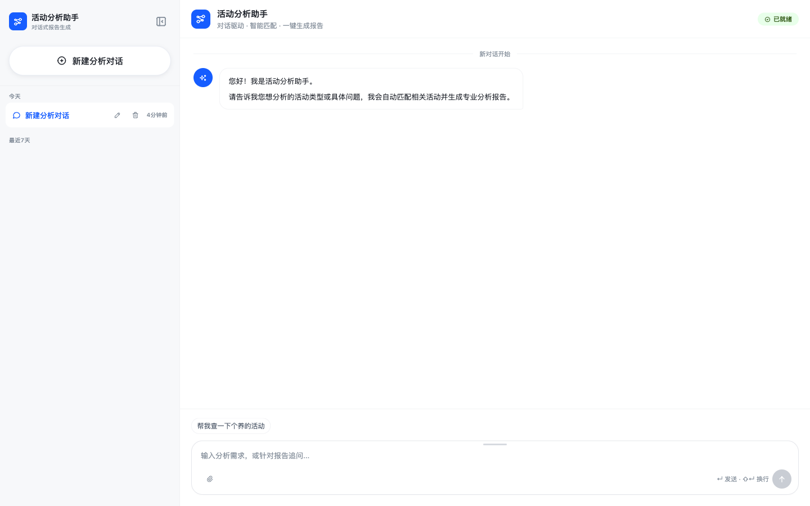

图 3-1 对话主界面

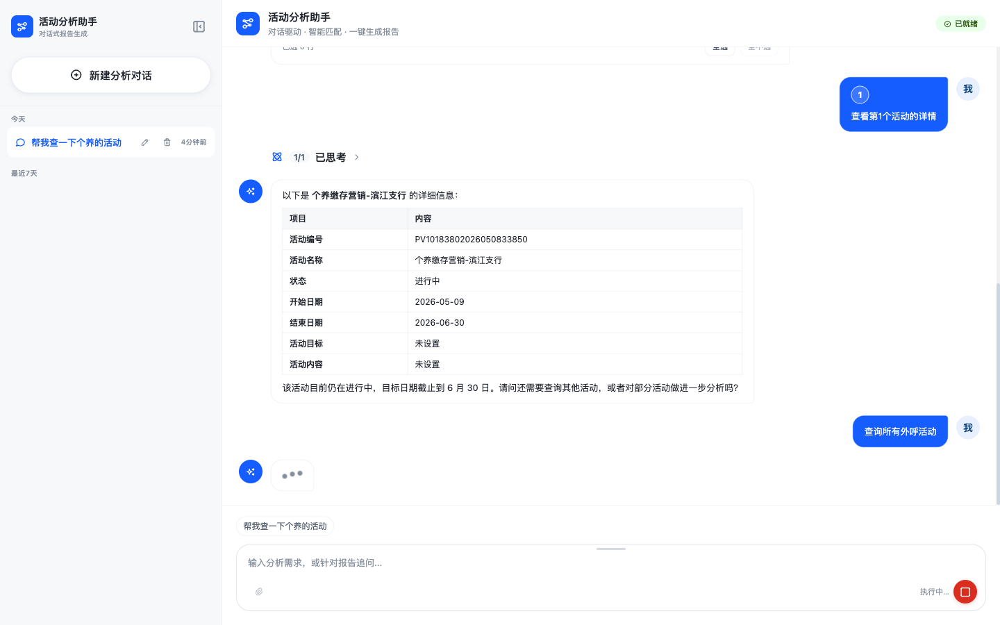

图 3-2 流式应答与执行过程展示

**操作步骤**

1. 进入系统，默认打开对话页；
2. 在底部输入框输入分析需求（Enter 发送，Shift+Enter 换行）；
3. 点击输入框右下角发送按钮（或按 Enter）提交；
4. 观察对话区展开的执行过程面板，各步骤状态随执行实时更新，底部浮动进度条同步显示当前步骤与整体进度；
5. 阅读系统流式返回的应答内容（文字说明、结果表格或报告卡片等）。

**输入/输出**

| 类别 | 项目 | 说明 |
|---|---|---|
| 输入 | 提问文本 | 手工输入的中文自然语言，非空；执行中或等待审批时输入框锁定，不可输入 |
| 输出 | 流式应答 | 系统逐步输出的回复内容，含文字说明、Markdown 表格、报告卡片等 |
| 输出 | 执行过程面板 | 执行计划各步骤的名称、状态（待处理/执行中/已完成/已跳过）与过程消息 |
| 输出 | 整体进度 | 已推进步骤数/总步骤数（n/N），展示于执行过程面板与底部浮动进度条 |

**业务规则与约束**

1. 同一会话同时仅允许一个运行中任务；任务运行中再次发起提问，系统拒绝并提示"出错了：该会话已有正在运行的任务，请先停止或等待完成"；
2. 任务执行中，输入框与文件上传处于锁定状态，发送按钮变为"停止"按钮；
3. 执行计划中被跳过的步骤标记为"已跳过"并注明原因；
4. 提问内容为空的，发送按钮不可用，无法提交。

## 3.2 快捷提问

#### F-CHAT-02 快捷提问

**功能描述**

输入框上方以标签形式展示推荐话术（快捷提问），话术内容由系统管理员在设置页统一维护（见 8.3 快捷提问管理）。用户点击某一话术标签，该话术即自动填入输入框，用户可直接发送，也可修改后发送。

**界面截图**


图 3-3 快捷提问

**操作步骤**

1. 查看输入框上方的推荐话术标签；
2. 点击目标话术标签，话术文本自动填入输入框；
3. 直接发送，或在输入框内修改后发送。

**输入/输出**

| 类别 | 项目 | 说明 |
|---|---|---|
| 输入 | 推荐话术选择 | 鼠标点击话术标签 |
| 输出 | 输入框预填文本 | 所选话术填入输入框并聚焦，可继续编辑 |

**业务规则与约束**

1. 仅展示后台配置为"启用"状态的话术，后台保存后实时生效；
2. 点击话术仅填入输入框，不自动发送；
3. 后台话术加载失败时，系统展示内置默认话术，不影响正常提问。

## 3.3 多轮对话与上下文

#### F-CHAT-03 多轮对话与上下文

**功能描述**

同一会话内支持连续多轮提问，系统自动保持对话上下文，用户可使用"第 1 个活动""刚才的报告"等指代性表述追问，无需重复提供前文信息。会话状态在服务端持久化保存：刷新页面或在会话列表中切换会话后，历史消息、执行过程记录、已生成的报告卡片及报告上下文均自动恢复，可在此基础上继续对话。

**界面截图**


图 3-4 会话切换与历史恢复

**操作步骤**

1. 在同一会话内连续提出多个问题，后续提问可引用前轮结果（如"查看第 1 个活动的详情"）；
2. 刷新页面，或在左侧会话列表切换至其他会话后再切回；
3. 确认历史消息、执行过程与报告卡片完整恢复，并继续追问。

**输入/输出**

| 类别 | 项目 | 说明 |
|---|---|---|
| 输入 | 多轮提问文本 | 同一会话内的连续自然语言提问，可含指代性表述 |
| 输出 | 上下文应答 | 系统结合本会话历史上下文生成的应答 |
| 输出 | 会话恢复内容 | 刷新/切换后恢复的历史消息、执行过程记录、报告卡片与版本信息 |

**业务规则与约束**

1. 上下文以会话为单位保持与隔离，不同会话之间互不影响；
2. 会话状态持久化于服务端，刷新页面或重新进入系统后仍可恢复；
3. 删除会话时，该会话的服务端会话数据一并删除，不可恢复（见 3.7 会话管理）。

## 3.4 分析视角切换

#### F-CHAT-04 分析视角切换

**功能描述**

系统预置三种专项分析视角：外呼活动分析、短信活动分析、综合运营分析，分别侧重外呼过程指标（接通率、挂机率、通话时长等）、短信触达指标（点击率、退订率、链接转化等）与综合运营指标（ROI、渠道占比、客群重叠度等）。分析视角**无独立界面开关**，由用户在对话中以自然语言指令触发：用户在提问中指定视角（如"用外呼活动分析视角重新分析""切换到短信活动分析视角"），系统在生成或重新生成报告时按指定视角调整分析口径，并在回复消息中确认当前视角（如"当前为综合运营分析视角"）。

**界面截图**


图 3-5 分析视角指令与系统确认

**操作步骤**

1. 在对话中发出含视角要求的指令，如"以短信活动分析视角重新生成该活动的分析报告"；
2. 系统按指定视角重新组织分析口径并生成报告；
3. 查看系统回复中对当前分析视角的确认说明及生成的报告。

**输入/输出**

| 类别 | 项目 | 说明 |
|---|---|---|
| 输入 | 视角切换指令 | 自然语言文本，需明确表达目标视角（外呼活动分析/短信活动分析/综合运营分析） |
| 输出 | 视角确认消息 | 回复中说明当前采用的分析视角 |
| 输出 | 专项分析报告 | 按指定视角口径生成的分析报告（见第 5 章 报告功能） |

**业务规则与约束**

1. 仅支持外呼活动分析、短信活动分析、综合运营分析三种预置视角；
2. 视角切换仅通过对话指令触发，系统不提供独立的界面切换控件；
3. 用户未指定视角时，由系统根据提问内容自动判断采用的分析口径。

## 3.5 文件上传（CSV/Excel）

#### F-CHAT-05 文件上传（CSV/Excel）

**功能描述**

用户可上传本地 CSV 或 Excel 文件作为分析数据源。支持两种上传方式：点击输入框左下角的附件（回形针）按钮选择文件；或将文件直接拖拽至输入框区域（拖拽时输入框显示"松开上传文件"提示遮罩）。上传成功后，输入框上方显示文件名附件条，可点击移除；输入框为空时系统自动预填"请基于上传的活动数据文件「文件名」生成分析报告"，用户确认或修改后发送，系统即基于该文件开展分析。

**界面截图**


图 3-6 文件上传

**操作步骤**

1. 点击输入框左下角附件按钮，在系统文件选择框中选定文件；或将文件拖拽至输入框区域后松开；
2. 等待上传完成，确认输入框上方出现文件名附件条；
3. 如需更换，点击附件条上的移除按钮后重新上传；
4. 确认或修改输入框中预填的分析要求，点击发送。

**输入/输出**

| 类别 | 项目 | 说明 |
|---|---|---|
| 输入 | 数据文件 | 本地 CSV/Excel 文件，扩展名为 .csv/.xls/.xlsx/.xlsm/.xltx/.xltm，单文件不超过 50MB |
| 输出 | 附件条 | 输入框上方展示已上传文件名，可移除 |
| 输出 | 预填提问文本 | 输入框为空时自动预填基于该文件生成分析报告的提问 |
| 输出 | 校验错误提示 | 文件类型不支持、超出大小限制或解析失败时，输入框上方显示错误原因 |

**业务规则与约束**

1. 仅支持 .csv、.xls、.xlsx、.xlsm、.xltx、.xltm 六种格式，其他类型直接拒绝并提示；
2. 单文件大小不超过 50MB，超出限制拒绝上传；
3. 文件上传后由服务端立即解析校验，生成数据摘要（行数、列数、列名与样例数据）供后续分析使用；解析失败的，已传文件自动删除并向用户提示失败原因；
4. 任务执行中或等待审批期间禁止上传，附件按钮与拖拽上传均不可用；
5. 同一提问仅携带一个附件，重复上传视为更换文件。

## 3.6 任务取消

#### F-CHAT-06 任务取消

**功能描述**

任务执行过程中，输入框右下角的发送按钮变为红色"停止"按钮。用户点击"停止"即可取消当前正在执行的任务；取消生效后，系统回复"任务已取消。"，执行过程面板随之关闭，输入框恢复可用，用户可继续提问。

**界面截图**


图 3-7 任务执行中的"停止"操作

**操作步骤**

1. 在任务执行过程中，点击输入框右下角红色"停止"按钮；
2. 等待系统响应，确认收到"任务已取消。"提示；
3. 输入框恢复可用后，继续新的提问。

**输入/输出**

| 类别 | 项目 | 说明 |
|---|---|---|
| 输入 | 停止操作 | 鼠标点击"停止"按钮（仅任务运行中可见） |
| 输出 | 取消结果 | 系统回复"任务已取消。"，执行过程面板结束，输入框恢复可用 |

**业务规则与约束**

1. 仅运行中的任务可以取消；任务未运行时无"停止"按钮；
2. 取消在流式事件间隙生效，非瞬时中断，点击后需等待系统响应；
3. 任务取消不影响已完成轮次的历史消息与已生成报告；
4. 取消后可立即发起新的提问。

## 3.7 会话管理

#### F-CHAT-07 会话管理

**功能描述**

左侧边栏为会话列表，按"今天""最近7天"分组展示当前用户的会话，支持新建、切换、重命名与删除。点击"新建分析对话"按钮创建新会话；点击会话条目切换会话；点击条目上的编辑图标重命名；点击删除图标并经二次确认后删除会话。会话标题默认由首条用户消息自动生成（取消息前 18 个字），用户可随时手动修改。删除全部会话后，系统自动补建一个新会话。

**界面截图**


图 3-8 会话管理

**操作步骤**

1. 新建：点击边栏顶部"新建分析对话"按钮，系统创建并切换到新会话；
2. 切换：点击会话列表中的目标会话条目，对话区恢复该会话内容；
3. 重命名：点击会话条目上的编辑图标，在编辑框中输入新标题并确认；
4. 删除：点击会话条目上的删除图标，在确认提示中点击确定，会话即被删除。

**输入/输出**

| 类别 | 项目 | 说明 |
|---|---|---|
| 输入 | 新建/切换操作 | 鼠标点击"新建分析对话"按钮或会话条目 |
| 输入 | 重命名标题 | 手工输入的新会话标题，非空 |
| 输入 | 删除确认 | 删除操作的二次确认 |
| 输出 | 会话列表 | 按"今天/最近7天"分组的会话条目，含标题与最近活跃时间 |
| 输出 | 会话内容 | 切换后恢复的会话消息、执行过程与报告卡片 |

**业务规则与约束**

1. 会话按用户隔离，仅展示当前用户本人的会话；
2. 新会话默认标题为"新建分析对话"，首条用户消息发送后自动以消息前 18 个字作为会话标题；
3. 重命名标题不能为空，留空视为放弃修改；
4. 删除会话需二次确认，删除后不可恢复，该会话的服务端会话数据一并删除；
5. 删除当前会话后自动切换到相邻会话；删除全部会话后，系统自动补建一个新会话并注册到服务端。

# 第4章 营销活动查询与分析队列

本章说明营销活动的查询与分析队列管理功能。用户在对话页以中文自然语言发出活动查询指令，系统对接行内营销活动系统返回活动列表；用户可在查询结果中点选活动、查看单活动详情，并将拟重点分析的活动加入当前会话的分析队列、按需移出或调整其分析配置。加入/移出队列与分析配置调整均属写操作，执行前须经人工审批（审批机制详见第 6 章）。本章共 4 个功能点：活动搜索、活动详情查看与点选、加入/移出分析队列、分析配置调整。

## 4.1 活动搜索

#### F-ACT-01 活动搜索

**功能描述**

用户在对话中以自然语言提出活动查询要求（如"查一下一季度的短信活动"），系统按条件调用行内营销活动查询接口，检索符合条件的营销活动，并在对话回复中以 Markdown 表格展示查询结果。支持的查询条件包括：关键词（活动名称、活动编号或纯数字编号片段，底层统一按活动名称模糊匹配）、活动类型（线上/线下）、渠道（如短信、外呼）、活动开始日期下限与活动结束日期上限。查询请求自动携带当前登录用户编号与来源系统编号，行内营销活动系统按该身份返回活动数据。单次查询最多返回 50 条活动，默认展示 20 条。结果表格包含序号、活动名称、活动编号、起止日期、状态等列；序号列固定从 1 开始编号，供用户以"第 2 行""第 1、3 行"等方式指代活动；活动状态与类型均以中文展示，不输出供应商原始状态码。

**界面截图**

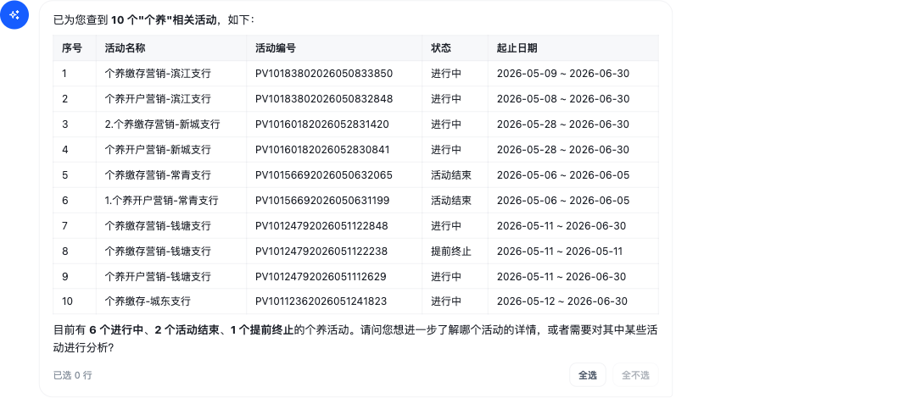

图 4-1 活动搜索结果

**操作步骤**

1. 在对话页输入框输入活动查询要求，如"查一下 2026 年一季度的短信活动"，点击发送；
2. 观察执行过程面板中"查询活动"步骤的执行状态；
3. 查看系统回复中的活动结果表格，逐行核对活动名称、编号、起止日期与状态；
4. 如需缩小范围，补充条件后继续提问（如"只看外呼渠道的"）；如需进一步操作，按序号指代活动（见 4.2 活动详情查看与点选）。

**输入/输出**

| 类别 | 项目 | 说明 |
|---|---|---|
| 输入 | 查询指令 | 中文自然语言文本，可包含关键词、活动类型、渠道、日期范围等条件 |
| 输出 | 活动结果表格 | Markdown 表格，含序号（row_number）、活动名称、活动编号、起止日期、状态等列，默认最多 20 条、单次上限 50 条 |
| 输出 | 查询失败提示 | 接口异常或无符合条件活动时，回复中如实说明原因或建议放宽条件 |

**业务规则与约束**

1. 关键词查询统一按活动名称模糊匹配，活动名称、活动编号、ID 或纯数字均作为关键词处理；
2. 单次查询返回结果上限 50 条，超出部分不返回；用户未指定条数时默认展示 20 条；
3. 结果表格的序号列固定从 1 开始，且仅在最近一次查询结果内有效；后续操作（详情查看、加入队列等）由系统自动将序号转换为真实活动编号执行，序号本身不作为活动编号使用；
4. 活动状态、活动类型以中文文案展示，系统禁止向用户输出供应商原始状态码；
5. 查询接口调用失败时系统自动重试一次，仍失败的如实向用户提示失败原因，不编造活动数据；
6. 未查询到符合条件的活动时，系统提示建议放宽关键词或日期范围后重试；
7. 查询请求携带的当前用户编号取自用户登录身份，来源系统编号由环境配置设定；可查询的活动范围以行内营销活动系统按该身份返回的结果为准。

## 4.2 活动详情查看与点选

#### F-ACT-02 活动详情查看与点选

**功能描述**

活动查询结果表格支持鼠标点选：用户点击表格中的数据行即可选中对应活动，选中行首的序号以圆点高亮标记；表格上方提供"全选""全不选"按钮，可批量选择或清空当次查询结果。已选活动随用户下一次提问一并提交，作为后续分析的操作对象。执行过程面板中，查询结果同时以活动卡片形式展示，每张卡片包含序号、活动名称、活动编号、起止日期、标签与摘要。此外，用户可通过对话指令查看单个活动的详情（如"查看第 2 个活动的详情"），系统优先取最近查询结果中的活动信息，未命中时回源行内接口按活动编号查询，并在回复中展示该活动的名称、编号、渠道、类型、状态、起止日期、运营目标与活动内容等完整字段。

**界面截图**

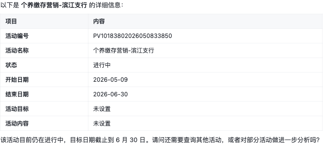

图 4-2 活动详情与点选

**操作步骤**

1. 在活动查询结果表格中，点击目标数据行选中活动（再次点击取消选中）；或点击表格上方"全选"/"全不选"按钮批量操作；
2. 选中后直接在输入框输入下一步要求（如"对比这几个活动的效果"）并发送，已选活动随提问提交；
3. 查看单个活动详情：在对话中输入"查看第 N 个活动的详情"或提供活动编号后发送；
4. 阅读系统回复中的活动详情，或在执行过程面板中查看活动卡片（名称、编号、起止日期、标签、摘要）。

**输入/输出**

| 类别 | 项目 | 说明 |
|---|---|---|
| 输入 | 行点选操作 | 鼠标点击查询结果表格的数据行，或点击"全选"/"全不选"按钮 |
| 输入 | 详情查看指令 | 自然语言文本，以序号（如"第 2 个"）或活动编号指代目标活动 |
| 输出 | 选中标记 | 选中行序号圆点高亮；已选活动随下一次提问一并提交 |
| 输出 | 活动卡片 | 执行过程面板中的活动卡片，含序号、名称、编号、起止日期、标签与摘要 |
| 输出 | 活动详情 | 单活动的名称、编号、渠道、类型、状态、起止日期、运营目标、活动内容等字段 |

**业务规则与约束**

1. 点选操作仅针对最近一次活动查询结果表格生效；在另一张查询结果表格中选择时，此前其他表格的草稿选择自动清空，避免序号来源混淆；
2. 已选活动仅作为用户下一次提问的输入随文提交，选择本身不触发任何写操作；
3. 详情查看优先使用本会话最近一次查询结果中的活动信息，未命中时回源行内接口按活动编号查询，回源请求同样携带当前登录用户编号与来源系统编号；
4. 目标活动未找到时，系统提示先用活动搜索查询核实，不凭空生成详情内容；
5. 执行过程面板中活动卡片超出展示数量时折叠显示，并提示"还有 N 个活动未展开"。

## 4.3 加入/移出分析队列（含审批）

#### F-ACT-03 加入/移出分析队列（含审批）

**功能描述**

分析队列是当前会话内用户拟重点分析活动的待分析清单。用户通过对话指令管理队列，如"把中秋促销活动加入分析队列""把某活动移出队列"。系统在执行加入操作前先经活动搜索核实活动真实存在，随后弹出审批卡片，列明操作说明与涉及的活动列表；用户点击"确认"后操作生效，点击"拒绝"则取消执行。加入时可一并指定该活动的分析视角、分析指标与分析维度（可选，见 4.4 分析配置调整）。操作完成后，系统回复本次处理结果：成功加入/移出的活动数量、因已在队列中而跳过的活动数量、未在最近查询结果中找到的活动数量，以及当前队列长度。分析队列为分析助手内部的会话级待分析清单，不修改行内营销活动系统中的任何数据。

**界面截图**


图 4-3 分析队列操作

**操作步骤**

1. 先通过活动搜索核实目标活动（见 4.1 活动搜索）；
2. 在对话中发出队列管理指令，如"把第 1、3 个活动加入分析队列"或"把某活动移出分析队列"；
3. 查看弹出的审批卡片，核对操作说明与涉及活动列表；
4. 点击"确认"执行，或点击"拒绝"取消；
5. 查看系统回复的处理结果（加入/移出数量、跳过数量、当前队列长度）。

**输入/输出**

| 类别 | 项目 | 说明 |
|---|---|---|
| 输入 | 队列管理指令 | 自然语言文本，明确表达加入或移出意图，并以序号或活动编号指代目标活动 |
| 输入 | 审批决策 | 审批卡片上的"确认"或"拒绝"操作 |
| 输出 | 审批卡片 | 展示操作名称、操作说明与涉及活动列表，等待人工决策 |
| 输出 | 处理结果 | 已加入/已移出数量、已在队列中而跳过的数量、未找到的数量及当前队列长度 |

**业务规则与约束**

1. 该操作需人工审批，详见第 6 章；用户拒绝后操作不执行，队列保持不变；
2. 系统执行加入操作前，先经活动搜索核实活动真实存在，不以用户口述直接加入未经核实的活动；
3. 仅当用户明确要求"加入/添加/放入分析队列"时才执行加入操作；用户勾选活动后直接询问"哪个效果更好""对比分析""下一步建议"等，属直接分析请求，系统直接基于已选活动生成分析报告，不加入队列、不触发审批；
4. 已在队列中的活动重复加入时自动跳过并在结果中注明；未在最近查询结果中找到的活动加入后标记为"未核实"；
5. 移出操作时，指定活动不在队列中的，系统提示"指定活动不在队列中"，队列保持不变；
6. 分析队列按会话隔离，仅对当前会话有效；队列操作不修改行内营销活动系统数据。

## 4.4 分析配置调整（含审批）

#### F-ACT-04 分析配置调整（含审批）

**功能描述**

用户可对分析队列中单个活动的分析配置进行调整，配置项包括：分析视角（外呼活动分析、短信活动分析、综合运营分析三种预置视角之一）、分析指标列表与分析维度列表。用户在对话中发出调整指令（如"把队列中某活动的分析视角改为短信活动分析""给某活动增加退订率指标"），系统弹出审批卡片，列明调整说明与涉及活动；用户点击"确认"后新配置生效，点击"拒绝"则维持原配置。调整结果在回复中确认，展示该活动更新后的完整配置与当前队列长度。调整后的配置在后续针对该活动生成分析报告时作为分析口径使用（见第 5 章报告功能）。

**界面截图**


图 4-4 分析配置调整

**操作步骤**

1. 确认目标活动已在分析队列中（见 4.3 加入/移出分析队列）；
2. 在对话中发出配置调整指令，明确目标活动与调整内容（视角、指标或维度）；
3. 查看审批卡片，核对调整说明与涉及活动；
4. 点击"确认"使新配置生效，或点击"拒绝"维持原配置；
5. 查看系统回复中更新后的分析配置与当前队列长度。

**输入/输出**

| 类别 | 项目 | 说明 |
|---|---|---|
| 输入 | 配置调整指令 | 自然语言文本，需明确目标活动（序号或活动编号）与调整内容（分析视角/分析指标/分析维度） |
| 输入 | 审批决策 | 审批卡片上的"确认"或"拒绝"操作 |
| 输出 | 审批卡片 | 展示操作名称、调整说明与涉及活动，等待人工决策 |
| 输出 | 更新结果 | 目标活动更新后的分析配置（视角/指标/维度）与当前队列长度 |

**业务规则与约束**

1. 该操作需人工审批，详见第 6 章；用户拒绝后配置维持原值；
2. 仅支持对已在分析队列中的活动调整配置；目标活动不在队列中时，系统提示该活动不在分析队列中，不做任何修改；
3. 分析视角仅支持外呼活动分析、短信活动分析、综合运营分析三种预置视角；指令中的视角无效时，系统拒绝执行并列出可选视角；
4. 每次调整仅更新指令中明确提供的配置项，未提及的配置项保持原值不变；
5. 配置调整按会话生效，不修改行内营销活动系统数据；调整后的配置在该活动后续生成报告时作为分析口径使用。

# 第5章 报告功能

本章说明分析报告的生成、预览、修改、导出、下载与反馈功能。用户在对话页以中文自然语言发出报告生成指令，系统基于分析队列中的活动、查询结果中已选活动或已上传的数据文件，生成图文结合的 HTML 交互式分析报告，并以报告卡片形式直接展示在对话中。报告支持多轮修改，每次修改经人工审批后生成新版本，版本链完整可查；报告可导出与下载为 PDF 或 HTML 文件，用户还可对每份报告进行点赞/点踩反馈。报告修改涉及审批的，审批机制详见第 6 章。本章共 6 个功能点：报告生成、报告预览与图表、报告多轮修改与版本管理、报告导出、报告下载、报告反馈。

## 5.1 报告生成

#### F-RPT-01 报告生成

**功能描述**

用户在对话中以自然语言提出报告生成要求（如"为队列中的活动生成分析报告""对比这几个活动的效果并出报告"），系统自动完成分析模板匹配、组件指标取数、数据清理与报告内容合成，生成一份图文结合的 HTML 交互式分析报告，包含数据图表（柱状图、饼图、折线图等）与叙述性分析文案，并以报告卡片形式展示在对话中。报告数据来源支持三种：当前会话分析队列中的活动（默认）、活动查询结果中已点选的活动、用户已上传的 CSV/Excel 数据文件。报告组织方式支持单活动深入分析、多活动各自分析、多活动综合分析与多活动对比分析，由系统按活动数量与匹配的分析模板自动确定。用户可在指令中一并指定分析视角（外呼活动分析、短信活动分析、综合运营分析）、分析指标、分析维度、图表类型偏好、报告主题色及其他补充分析要求。报告生成过程中，执行过程面板逐步展示各环节进展；生成的报告须通过系统展示校验后方可展示，校验未通过时系统自动重试重生成。

**界面截图**

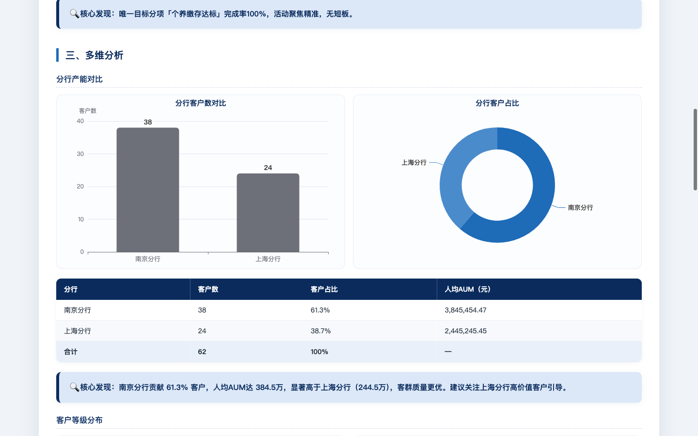

图 5-1 报告生成结果

**操作步骤**

1. 准备分析对象：将目标活动加入分析队列（见 4.3 加入/移出分析队列），或在活动查询结果中点选活动（见 4.2 活动详情查看与点选），或上传数据文件（见 3.5 文件上传）；
2. 在对话页输入框输入报告生成要求，如"为队列中的活动生成综合分析报告"，可一并说明视角、指标、维度等要求，点击发送；
3. 观察执行过程面板中报告生成各环节的执行状态；
4. 生成完成后，查看对话中出现的报告卡片，浏览报告内容（预览与操作见 5.2 报告预览与图表）。

**输入/输出**

| 类别 | 项目 | 说明 |
|---|---|---|
| 输入 | 报告生成指令 | 中文自然语言文本，可包含分析视角、分析指标、分析维度、图表类型偏好、主题色及自由文本补充要求 |
| 输入 | 分析对象 | 分析队列中的活动（默认）、查询结果中已选活动或已上传数据文件 |
| 输出 | 报告卡片 | 对话中展示的 HTML 报告卡片，含报告标题、版本徽章、图表与叙述文案 |
| 输出 | 生成失败提示 | 无可用分析对象或生成过程异常时，回复中如实说明原因 |

**业务规则与约束**

1. 分析视角仅支持外呼活动分析、短信活动分析、综合运营分析三种预置视角；指令中的视角无效时，系统拒绝执行并列出可选视角；
2. 使用外呼活动分析视角时，系统先核实所选活动是否为外呼活动：所选活动均不是外呼活动时，系统提示无法使用该视角分析；多活动中混有非外呼活动时，系统先向用户说明情况并请求确认，用户确认后继续生成，非外呼活动按数据模板取数并采用多活动分析模板；
3. 以上传文件为数据来源时，系统仅基于上传文件内容取数分析，不查询行内活动数据接口；取数或解析失败时如实提示，不自动切换为在线活动数据源；
4. 报告生成完成后须通过系统展示校验，校验未通过时系统自动重试重生成；多次重试仍未通过时，系统如实提示报告生成失败，不展示内容不完整的报告；
5. 无可用分析对象（分析队列为空、未点选活动且无已上传文件）时，系统提示先准备分析对象，不凭空生成报告；
6. 生成过程中可点击"停止"取消任务（见 3.6 任务取消）；生成耗时较长属正常现象，执行过程面板实时展示进展；
7. 报告生成不修改行内营销活动系统数据，分析口径以生成指令及队列中活动的分析配置为准（见 4.4 分析配置调整）。

## 5.2 报告预览与图表

#### F-RPT-02 报告预览与图表

**功能描述**

报告生成后，系统在对话中以报告卡片形式内嵌展示报告全文预览。预览区域在隔离的沙箱环境中渲染报告内容，报告中的数据图表（柱状图、饼图、折线图、数据表格等）完整呈现，预览高度随报告内容自适应。报告卡片顶部展示报告标题与格式说明，并提供"全屏"按钮，点击后在浏览器新页签中全屏打开报告，便于细读与投屏汇报。

**界面截图**


图 5-2 报告预览与图表

**操作步骤**

1. 生成报告后，在对话中找到报告卡片，上下滚动浏览报告预览；
2. 查看报告中的图表与数据表格，核对分析结论；
3. 如需全屏查看，点击报告卡片右上方"全屏"按钮，在浏览器新页签中阅读报告；阅读完毕关闭该页签即可。

**输入/输出**

| 类别 | 项目 | 说明 |
|---|---|---|
| 输入 | 全屏操作 | 点击报告卡片"全屏"按钮 |
| 输出 | 报告预览 | 报告卡片内嵌展示的报告全文，含图表、数据表格与叙述文案，高度自适应 |
| 输出 | 全屏报告 | 浏览器新页签中全屏展示的报告页面 |

**业务规则与约束**

1. 报告预览在隔离的沙箱环境中渲染，仅允许执行报告自带的图表脚本，不影响对话页其他功能；
2. 全屏打开依赖浏览器弹出新页签，浏览器拦截弹出窗口时系统提示允许弹出后重试；
3. 报告卡片展示的是该报告的最新版本内容；历史版本内容可在运行历史页查看（见 5.3 报告多轮修改与版本管理、第 9 章历史与日志）；
4. 报告中的图表由报告文件自带脚本渲染，预览与全屏打开均需浏览器支持 JavaScript。

## 5.3 报告多轮修改与版本管理

#### F-RPT-03 报告多轮修改与版本管理

**功能描述**

用户可对已生成的报告提出多轮修改要求。修改要求在对话中以自然语言提出，支持四类：内容修改（如"增加客群规模章节""把结论写得更简洁"）、图表替换（如"把第一个图改成饼图"）、样式调整（如"使用深色主题""标题居中"）与自由文本修改要求。报告修改属写操作，系统先弹出审批卡片列明修改说明，用户点击"确认"后系统在原报告基础上执行修改并生成新版本，点击"拒绝"则维持原报告不变（审批机制详见第 6 章）。报告版本按生成次序递增管理：首次生成为第 1 版，之后每次修改依次递增，报告卡片左上方以"v{N}版本"徽章展示当前版本号。版本超过一个时，报告卡片提供"修改历史"入口，点击展开版本列表，逐行展示各版本的版本号、来源动作（生成/修改）与变更说明摘要。报告卡片始终展示最新版本，完整版本链（含各版本内容与反馈状态）可在运行历史页查看（见第 9 章历史与日志）。

**界面截图**


图 5-3 报告版本与修改历史

**操作步骤**

1. 在报告卡片对应的对话中输入修改要求，如"在报告开头增加核心发现章节，用三个要点概括结论"，点击发送；
2. 查看弹出的审批卡片，核对修改说明；
3. 点击"确认"执行修改，或点击"拒绝"维持原报告；
4. 修改完成后，查看报告卡片更新后的内容与递增的版本徽章；
5. 点击报告卡片上的"修改历史"，展开查看各版本的来源动作与变更说明。

**输入/输出**

| 类别 | 项目 | 说明 |
|---|---|---|
| 输入 | 修改指令 | 中文自然语言文本，可包含内容修改、图表替换、样式调整要求或自由文本修改要求 |
| 输入 | 审批决策 | 审批卡片上的"确认"或"拒绝"操作 |
| 输出 | 审批卡片 | 展示修改操作说明，等待人工决策 |
| 输出 | 新版本报告 | 报告卡片更新为最新版本内容，版本徽章递增 |
| 输出 | 修改历史 | 可展开的版本列表，含版本号、来源动作（生成/修改）与变更说明摘要 |

**业务规则与约束**

1. 报告修改需人工审批，详见第 6 章；用户拒绝后报告维持原版本不变；
2. 每次修改基于当前最新版本执行，修改成功后生成新版本，历史版本内容完整保留，不被覆盖；
3. 版本号按生成次序连续递增，报告卡片始终展示最新版本与对应的版本徽章；
4. 修改后的报告同样须通过系统展示校验后方可展示，校验未通过时系统自动重试；
5. 仅当会话中存在已生成的报告时可提出修改要求；无报告时系统提示先生成报告；
6. 系统不提供报告回滚操作；如需恢复历史版本内容，可在运行历史页下载对应版本（见 5.5 报告下载）。

## 5.4 报告导出（PDF/HTML）

#### F-RPT-04 报告导出（PDF/HTML）

**功能描述**

系统支持将报告导出为 PDF 或 HTML 格式，入口有两种：

1. 报告卡片按钮导出：报告卡片右上方提供"导出 PDF"与"下载 HTML"按钮，点击后系统将当前报告内容提交后端转换为对应格式文件，浏览器自动下载到本地，文件名由报告标题与日期组成。导出的 PDF 按报告实际版面整页排版，完整保留报告排版、图表与中文字体；导出的 HTML 为单个文件，图表脚本已内联，离线双击即可在浏览器中打开查看。导出进行期间，页面展示全屏进度遮罩（提示"正在导出 PDF/HTML 报告…请稍候，不要关闭当前页面"），导出按钮暂时置灰，导出完成后自动恢复；
2. 对话指令导出：用户在对话中以自然语言提出导出要求（如"把报告导出为 PDF""把报告导出为 HTML 文件"），系统将当前报告导出为指定格式（PDF 或 HTML）的文件；导出成功后，回复消息下方展示"下载 PDF 报告"或"下载 HTML 报告"按钮，点击即可直接下载对应文件。导出文件默认以"report-报告编号"命名，用户可在指令中另行指定文件名。

**界面截图**


图 5-4 报告导出入口

**操作步骤**

1. 报告卡片按钮导出：在报告卡片右上方点击"导出 PDF"按钮，等待页面导出进度提示结束，浏览器自动下载 PDF 文件，在浏览器下载记录或本地下载目录中查看；
2. 对话指令导出：在对话中输入"把报告导出为 PDF"或"把报告导出为 HTML"，点击发送；
3. 查看系统回复中的导出结果，点击回复下方的"下载 PDF 报告"（或"下载 HTML 报告"）按钮，浏览器自动下载对应格式文件。

**输入/输出**

| 类别 | 项目 | 说明 |
|---|---|---|
| 输入 | 导出按钮点击 | 报告卡片右上方"导出 PDF"按钮 |
| 输入 | 导出指令 | 中文自然语言文本，需明确导出格式（PDF 或 HTML），可指定文件名 |
| 输出 | PDF 文件 | 浏览器直接下载的 PDF 文件，按报告实际版面整页排版，完整保留报告排版、图表与中文字体 |
| 输出 | 导出结果回复与下载按钮 | 对话指令导出时，回复告知导出结果，回复下方展示"下载 PDF/HTML 报告"按钮，点击直接下载 |

**业务规则与约束**

1. 报告卡片"导出 PDF"按钮受系统特性开关控制，当前已开启并正常显示；开关配置详见 10.2 特性开关；
2. 导出格式仅支持 PDF 与 HTML；用户要求导出 Word（DOCX）等其他格式时，系统明确说明当前仅支持导出 PDF 或 HTML，不执行导出；
3. 对话指令导出的文件默认命名为"report-报告编号"，用户可在指令中指定文件名（不含扩展名），非法字符自动替换；
4. 导出指令中的格式不受支持时，系统拒绝执行并提示"当前仅支持导出 PDF 或 HTML，不支持 DOCX"；
5. 会话中无已生成报告时，系统提示"当前没有可导出的报告"；
6. 导出进行期间页面展示全屏进度遮罩，导出按钮暂时置灰以防止重复提交，请勿在导出期间关闭页面；
7. 导出失败时，系统如实提示失败原因（如"导出 PDF 失败：…"），用户可重试。

## 5.5 报告下载

#### F-RPT-05 报告下载

**功能描述**

系统提供两类报告下载入口：

1. 对话报告卡片下载：报告卡片右上方提供"下载 HTML"与"导出 PDF"按钮。"下载 HTML"按钮将当前报告下载为单个 HTML 文件，图表脚本已内联，文件离线双击即可在浏览器中打开查看，文件名为"活动分析报告-日期.html"；"导出 PDF"按钮下载 PDF 文件（导出逻辑见 5.4 报告导出）；
2. 运行历史页按版本下载：在运行历史页打开会话详情，展开某份报告的版本列表后，每个版本行均提供"HTML"与"PDF"下载按钮，可按版本下载对应历史版本的报告文件（运行历史页详见第 9 章历史与日志）。

**界面截图**


图 5-5 报告下载入口

**操作步骤**

1. 对话报告卡片下载：在报告卡片右上方点击"下载 HTML"或"导出 PDF"按钮，浏览器自动下载对应格式文件，在浏览器下载记录或本地下载目录中查看；
2. 运行历史页下载：进入运行历史页，找到目标会话，点击"查看"打开会话详情；
3. 在会话详情中展开目标报告的版本列表，在需要的版本行点击"HTML"或"PDF"，浏览器自动下载该版本的报告文件。

**输入/输出**

| 类别 | 项目 | 说明 |
|---|---|---|
| 输入 | 下载按钮点击 | 报告卡片"下载 HTML"/"导出 PDF"按钮，或运行历史页版本行的"HTML"/"PDF"按钮 |
| 输出 | HTML 报告文件 | 单文件 HTML，图表脚本内联，离线可直接打开，文件名为"活动分析报告-日期.html" |
| 输出 | PDF 报告文件 | PDF 格式报告文件，运行历史页按所选版本实时转换生成 |

**业务规则与约束**

1. 对话报告卡片下载的均为该报告当前最新版本；下载历史版本须通过运行历史页按版本操作；
2. 下载的 HTML 文件为独立单文件，不依赖系统在线环境，可离线打开，图表正常展示；
3. 运行历史页的 PDF 下载按所选版本实时转换，转换需数秒，请等待浏览器下载开始；
4. 报告卡片"导出 PDF"按钮受系统特性开关控制，当前已开启并正常显示；运行历史页版本行的"PDF"按钮同样受该开关控制；
5. 下载失败时系统弹出提示说明原因，用户可重试。

## 5.6 报告反馈

#### F-RPT-06 报告反馈

**功能描述**

用户可对对话中的每份报告进行满意度反馈。报告卡片右上方提供点赞与点踩按钮：点击点赞按钮即记录好评；点击点踩按钮后弹出原因填写框，可填写点踩原因（选填，不超过 500 字），点击"提交"记录反馈，或点击"跳过"不填原因直接提交。再次点击已选中的反馈按钮可取消本次反馈；在点赞与点踩之间可直接切换。反馈记录实时入库，运行历史页会话列表展示各会话的点赞/点踩计数，并支持按反馈状态（全部反馈/有点赞/有点踩/未反馈）筛选会话，供运营人员汇总分析报告质量（运行历史页详见第 9 章历史与日志）。

**界面截图**


图 5-6 报告反馈

**操作步骤**

1. 在报告卡片右上方点击点赞按钮记录好评；或点击点踩按钮，在弹出的原因填写框中填写点踩原因（选填）后点击"提交"，或点击"跳过"直接提交；
2. 如需取消反馈，再次点击已选中的反馈按钮；如需改评，直接点击另一反馈按钮；
3. 进入运行历史页，查看各会话的点赞/点踩计数；使用反馈状态筛选条件，检索有点赞、有点踩或未反馈的会话。

**输入/输出**

| 类别 | 项目 | 说明 |
|---|---|---|
| 输入 | 反馈操作 | 点击报告卡片点赞/点踩按钮；再次点击同值取消，点击异值切换 |
| 输入 | 点踩原因 | 自由文本，选填，不超过 500 字 |
| 输出 | 反馈状态 | 按钮高亮标记当前反馈状态（点赞/点踩），取消后恢复未反馈状态 |
| 输出 | 反馈统计与筛选 | 运行历史页会话列表的点赞/点踩计数，及按反馈状态的筛选结果 |

**业务规则与约束**

1. 每份报告同一用户同一时间仅保留一种反馈状态（点赞或点踩），重复点击同值视为取消，点击异值直接切换；
2. 点踩原因为选填，长度不超过 500 字；填写内容随反馈一并入库；
3. 反馈按报告版本归属记录，并在运行历史记录中按版本展示；
4. 反馈记录持久化保存，刷新页面或切换会话后报告卡片恢复显示已提交的反馈状态；
5. 无运行记录的报告（如历史遗留消息）无法提交反馈，反馈按钮置灰不可用；
6. 反馈提交失败时，报告卡片上提示失败原因，反馈状态保持不变，用户可重试。

# 第6章 HITL 人工审批

本章说明系统的人工审批（HITL，Human-in-the-Loop）功能。为防止系统直接执行影响分析口径与报告内容的写操作，系统将"加入分析队列、移出分析队列、调整分析配置、修改报告"四类操作纳入人工审批范围：每当系统在对话执行过程中发起上述操作时，任务自动暂停并向用户弹出审批卡片，列明操作说明与涉及对象，由用户决策"确认"或"拒绝"后方可继续。审批期间对话输入与文件上传暂时锁定；审批卡片及其处理状态随会话持久保存，刷新页面或切换会话后原样恢复，待审批任务可从中断处继续执行。本章共 3 个功能点：审批触发机制、审批卡片操作、刷新恢复审批状态。

## 6.1 审批触发机制

#### F-HITL-01 审批触发机制

**功能描述**

系统在对话执行过程中自动识别需要人工审批的写操作并暂停任务，无需用户额外设置。纳入审批范围的操作共四类：加入分析队列、移出分析队列、调整分析配置、修改报告。当系统按用户指令准备执行上述任一操作时，当前任务立即暂停，对话中弹出审批卡片，列明操作名称、操作说明与涉及的活动列表（或修改说明），等待用户决策；在用户作出决策之前，系统不执行该操作。审批等待期间，对话输入框与文件上传功能暂时锁定，输入框下方提示"等待审批…"，执行过程面板中对应步骤显示为暂停状态。除上述四类写操作外，活动查询、报告生成、报告导出等操作不触发审批，系统直接执行。

**界面截图**


图 6-1 审批触发后的审批卡片

**操作步骤**

被动触发，无需操作。用户在对话中发出涉及写操作的指令（如"把该活动加入分析队列""把报告第一个图改成饼图"）后，系统自动暂停任务并弹出审批卡片，用户按 6.2 审批卡片操作进行决策即可。

**输入/输出**

| 类别 | 项目 | 说明 |
|---|---|---|
| 输入 | 写操作指令 | 中文自然语言文本，经系统理解后落入四类审批范围操作之一 |
| 输出 | 审批卡片 | 对话中弹出的待审批卡片，含操作名称、操作说明、涉及活动列表或修改说明，以及"拒绝""确认"按钮 |
| 输出 | 界面锁定提示 | 审批等待期间输入框与文件上传锁定，输入框下方提示"等待审批…"，执行过程面板对应步骤显示暂停 |

**业务规则与约束**

1. 仅加入分析队列、移出分析队列、调整分析配置、修改报告四类写操作触发审批；活动搜索、活动详情查看、报告生成、报告导出与下载等操作不触发审批；
2. 审批卡片弹出后、用户作出决策前，系统不执行对应写操作，相关对象（分析队列、分析配置、报告）保持原状；
3. 审批等待期间，当前会话的输入框与文件上传暂时锁定，用户不能发送新消息或上传文件，决策后自动解除锁定；
4. 同一会话同一时刻仅存在一张待审批卡片，待决策完成后任务方可继续推进；
5. 审批触发不改变指令本身的含义：系统按用户原始指令生成审批内容，卡片所列操作说明与涉及对象即实际待执行的内容。

## 6.2 审批卡片操作

#### F-HITL-02 审批卡片操作

**功能描述**

审批卡片是用户对写操作进行人工决策的界面。卡片顶部展示操作名称（如"加入分析队列"）与操作说明（如"请确认是否执行「加入分析队列」"）；卡片中部列出本次操作涉及的活动清单（序号、活动名称、活动编号），报告修改等不涉及活动清单的操作则展示具体修改说明（内容修改、图表替换、样式调整及其他要求）；卡片底部提供"拒绝"与"确认"两个按钮。点击"确认"后，系统按卡片所列内容执行该写操作并继续后续任务流程；点击"拒绝"后，该操作取消执行，系统在后续回复中说明操作已被拒绝，相关对象保持原状。决策提交后，卡片自动折叠并以文字标记处理结果（"已确认"或"已拒绝"），按钮不再可用；点击卡片右上角的展开/折叠箭头，可随时回看当时的审批内容。

**界面截图**


图 6-2 审批卡片操作

**操作步骤**

1. 查看对话中弹出的审批卡片，核对操作名称与操作说明；
2. 核对卡片中部的涉及活动清单（序号、活动名称、活动编号），或阅读报告修改的具体修改说明；
3. 确认无误后点击"确认"执行该操作；如不同意执行，点击"拒绝"；
4. 观察卡片折叠为"已确认"或"已拒绝"状态，并查看系统继续执行的过程消息与最终回复；
5. 如需回看审批内容，点击已处理卡片右上角的展开箭头。

**输入/输出**

| 类别 | 项目 | 说明 |
|---|---|---|
| 输入 | 审批决策 | 点击审批卡片"确认"或"拒绝"按钮 |
| 输出 | 操作执行结果 | 决策为"确认"时，系统执行该写操作并在回复中给出处理结果（如加入/移出数量、更新后的分析配置、报告新版本） |
| 输出 | 拒绝结果回复 | 决策为"拒绝"时，操作不执行，系统回复说明操作已被拒绝，相关对象保持原状 |
| 输出 | 卡片状态 | 卡片折叠并标记"已确认"或"已拒绝"，可展开回看，按钮不再可用 |

**业务规则与约束**

1. 审批决策仅"确认""拒绝"两种，审批内容不可在界面上修改；如需调整操作内容，应点击"拒绝"后以新的指令重新发起；
2. 决策一经提交不可撤销：已处理卡片的按钮置为不可用，仅保留处理结果状态供查看；
3. 决策提交后因网络异常等原因未能恢复执行时，卡片自动恢复为待审批状态，用户可重新决策；
4. 点击"确认"后，系统严格按照卡片所列内容执行，不擅自扩大操作范围；
5. 点击"拒绝"后，相关对象（分析队列、分析配置、报告）保持原状，用户可继续通过对话提出新的要求；
6. 审批卡片不可删除，作为操作留痕随会话消息一并保存（见 6.3 刷新恢复审批状态）。

## 6.3 刷新恢复审批状态

#### F-HITL-03 刷新恢复审批状态

**功能描述**

审批卡片及其处理状态随会话消息一并持久保存。用户刷新浏览器页面，或切换到其他会话后再切回，对话中的审批卡片原样恢复：尚未决策的卡片仍显示"拒绝""确认"按钮，可继续审批；已处理的卡片仍显示"已确认"或"已拒绝"状态，可展开回看。对于待审批的卡片，系统在服务端完整保留任务暂停时的执行现场，用户刷新页面后再作出决策，任务从暂停处继续执行，无需重新提问，执行结果与未刷新时一致。

**界面截图**


图 6-3 刷新后恢复的审批卡片

**操作步骤**

1. 在存在审批卡片（待审批或已处理）的会话中，刷新浏览器页面，或切换至其他会话后再切回本会话；
2. 查看对话中恢复显示的审批卡片：待审批卡片按钮可用，已处理卡片显示处理结果；
3. 对待审批卡片点击"确认"或"拒绝"，观察任务从暂停处继续执行并查看最终结果。

**输入/输出**

| 类别 | 项目 | 说明 |
|---|---|---|
| 输入 | 页面刷新/会话切换 | 浏览器刷新，或在会话列表中切换会话后切回 |
| 输出 | 恢复的审批卡片 | 待审批卡片恢复为可决策状态；已处理卡片恢复为"已确认"/"已拒绝"状态 |
| 输出 | 续执行结果 | 刷新后完成审批决策，任务从暂停处继续执行，回复最终处理结果 |

**业务规则与约束**

1. 审批卡片及其处理状态随会话持久保存，刷新页面、切换会话、重新进入系统后均不丢失；
2. 待审批任务在服务端保留执行现场，刷新后作出决策可断点续执行，此前已完成的执行步骤不重复执行；
3. 审批状态按会话隔离保存，各会话的审批卡片互不影响；
4. 已处理卡片的决策结果不可因刷新而回退，按钮保持不可用状态；
5. 待审批期间关闭浏览器后重新进入会话，审批卡片仍然有效，可正常决策并继续执行。

# 第7章 技能（SKILL）管理

本章说明技能（SKILL）管理功能。技能是系统在生成分析报告时可复用的分析组件，每项技能由名称、所属分类、简述与执行模板构成。技能管理页面向管理人员提供技能清单查询、分类维护及技能的新增、编辑与删除；组件编排页面向分析人员提供基于画布的技能编排能力，可将技能组件按需组合为本次分析的分析框架。本章共 3 个功能点：技能清单与分类、技能编排（画布）、技能新增/编辑/删除。

## 7.1 技能清单与分类

#### F-SKILL-01 技能清单与分类

**功能描述**

用户通过侧边导航"SKILL"进入技能管理页，页面以表格展示全部技能，列项包括 SKILL 名称、分类、简述、模板预览、已应用次数与操作入口。表格上方提供分类筛选下拉框与技能名称关键字搜索框，两者可组合使用，页面底部实时显示符合筛选条件的技能条数。"已应用"列为系统统计值，不提供人工修改入口。页面右上角提供"分类管理"入口，弹窗内展示各分类的名称、说明与旗下技能数量，支持新增分类与删除分类：新增分类需填写分类名称（必填）与分类说明（选填）；删除分类时，该分类下全部技能自动迁移至默认分类后再删除分类本身，默认分类（分类列表首个，标注"默认"）不可删除。

**界面截图**

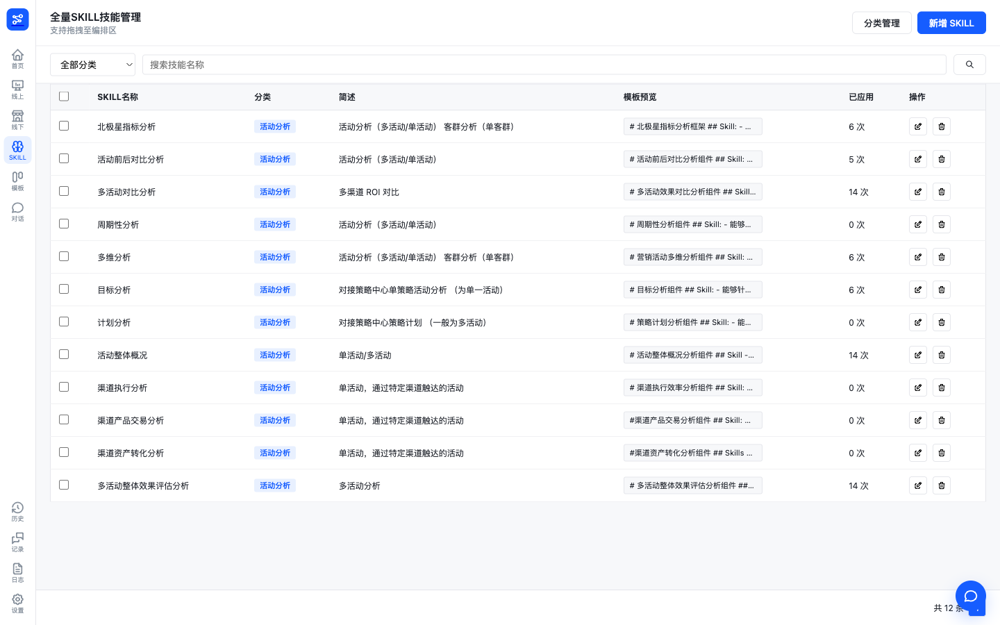

图 7-1 技能管理界面

**操作步骤**

1. 在侧边导航点击"SKILL"，进入技能管理页；
2. 浏览技能表格，核对各技能的名称、分类、简述、模板预览与已应用次数；
3. 在分类下拉框中选择目标分类，或在搜索框中输入技能名称关键字，列表即时按条件过滤，底部显示"共 N 条"；
4. 点击页面右上角"分类管理"，在弹窗中查看各分类的名称、说明与技能数量；
5. 新增分类：在弹窗顶部输入分类名称与分类说明，点击"添加"；
6. 删除分类：点击目标分类行内的删除图标，该分类下技能自动迁移至默认分类，分类随即删除；默认分类行显示"不可删除"，无删除入口。

**输入/输出**

| 类别 | 项目 | 说明 |
|---|---|---|
| 输入 | 分类筛选 | 下拉选择，含"全部分类"与全部分类清单 |
| 输入 | 关键字搜索 | 按技能名称模糊匹配，可与分类筛选组合使用 |
| 输入 | 分类名称/说明 | 新增分类时填写，名称为必填项，说明为选填项 |
| 输出 | 技能列表 | 表格展示 SKILL 名称、分类、简述、模板预览、已应用次数与操作入口，底部显示符合条件条数 |
| 输出 | 分类管理列表 | 弹窗内展示各分类名称、说明、技能数量与删除入口，默认分类标注"默认" |
| 输出 | 操作失败提示 | 数据加载或分类操作失败时，页面顶部以红色提示条展示失败原因 |

**业务规则与约束**

1. 关键字搜索仅按技能名称模糊匹配，不匹配简述或模板内容；分类筛选与关键字搜索同时生效；
2. 默认分类为分类列表首个分类，不可删除；删除其他分类时，其下全部技能自动迁移至默认分类，不产生无归属技能；
3. 分类名称必填，未填写时"添加"按钮不可用；新增同名分类时系统沿用已有分类，不重复创建；
4. "已应用"次数为系统统计值，不提供人工修改入口；
5. 技能清单数据与组件编排页组件库同源，技能的新增、编辑、删除实时反映至组件库。

## 7.2 技能编排（画布）

#### F-SKILL-02 技能编排（画布）

**功能描述**

组件编排页为分析向导的第 2 步，用户在完成数据源配置后进入该页编排本次分析的分析框架。页面顶部锁定条展示向导第 1 步已锁定的活动类型、数据源与统计周期。页面左侧为 SKILL 组件库，实时从服务端拉取技能清单并按分类分组展示，每张组件卡片展示技能名称、简述与已应用次数；用户可将组件卡片拖拽至中间画布，或双击卡片直接添加。画布内组件按序排列，支持拖拽调整顺序、通过卡片上的"上移""下移"按钮逐位调整，并可点击"×"将组件移出画布。首次进入页面时，系统自动载入默认分析框架（技能列表前 5 个组件）；底部操作条提供"重置AI默认框架"按钮，一键将画布恢复为默认分析框架。页面右侧为活动分析助手对话区，画布的添加、移动与重置操作会在对话区同步提示。编排完成后，可经底部按钮返回上一步或进入向导下一步生成分析报告。

**界面截图**

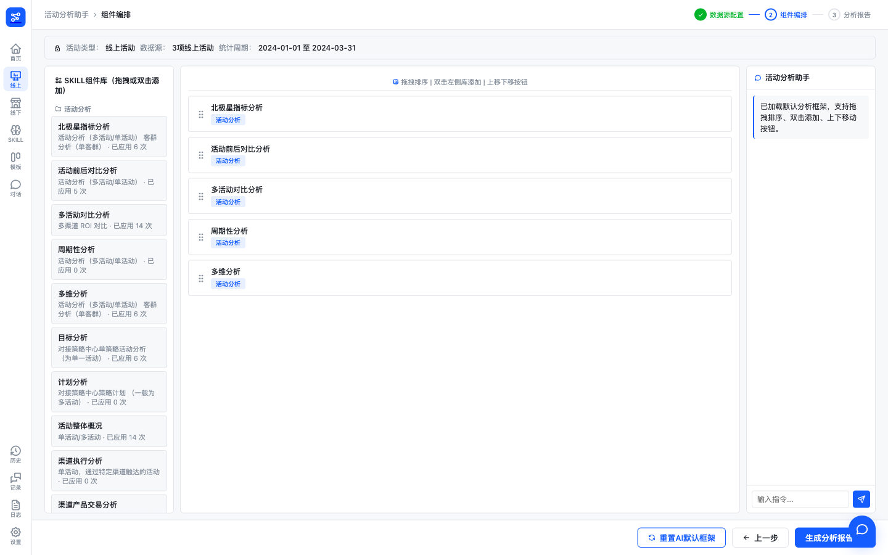

图 7-2 技能编排画布

**操作步骤**

1. 从管理首页选择分析类型进入分析向导，完成第 1 步数据源配置后进入组件编排页；
2. 查看顶部锁定条，确认本次分析的活动类型、数据源与统计周期；
3. 在左侧 SKILL 组件库中按分类浏览组件卡片，将目标组件拖拽至画布，或双击组件卡片添加；
4. 在画布内拖拽组件调整顺序，或使用组件卡片上的"上移""下移"按钮逐位调整；
5. 点击组件卡片上的"×"移除不需要的组件；
6. 如需恢复初始编排，点击底部"重置AI默认框架"；
7. 编排完成后，点击"上一步"返回数据源配置，或点击"生成分析报告"进入向导下一步。

**输入/输出**

| 类别 | 项目 | 说明 |
|---|---|---|
| 输入 | 组件添加操作 | 拖拽组件库卡片至画布，或双击组件卡片 |
| 输入 | 排序/移除操作 | 画布内拖拽排序、"上移"/"下移"按钮、卡片"×"移除 |
| 输入 | 重置操作 | 底部"重置AI默认框架"按钮 |
| 输出 | SKILL 组件库 | 按分类分组的组件卡片，含技能名称、简述与已应用次数，数据实时取自服务端技能清单 |
| 输出 | 画布分析框架 | 按序排列的组件列表，每张卡片展示组件名称与分类标签 |
| 输出 | 锁定条 | 展示已锁定的活动类型、数据源与统计周期 |
| 输出 | 操作提示 | 添加、移动、重置等画布操作在右侧对话区同步提示 |

**业务规则与约束**

1. 组件库数据实时取自服务端技能清单，与技能管理页维护的数据一致；已被删除的技能不再出现在组件库中；
2. 同一组件允许重复添加至画布，每次添加在画布末尾生成一个组件实例；
3. 画布为空时展示空态提示"暂无分析组件，请从左侧拖拽或双击添加 SKILL"；
4. 首次进入页面时自动载入默认分析框架（技能列表前 5 个组件）；"重置AI默认框架"将画布整体恢复为该默认框架，当前编排内容不保留；
5. 顶部锁定条内容在向导第 1 步确定，编排页内仅供查看，不可修改；
6. 画布编排仅在组件卡片非按钮区域可发起拖拽，点击"上移""下移""×"按钮时不触发拖拽。

## 7.3 技能新增/编辑/删除

#### F-SKILL-03 技能新增/编辑/删除

**功能描述**

在技能管理页，用户可对技能进行新增、编辑与删除。点击页面右上角"新增 SKILL"打开新增弹窗，表单字段包括技能名称（必填）、分类（下拉选择，取自现有分类清单）、简述（选填）与执行模板（多行文本，选填）；点击"保存"后技能即时生效并出现在技能列表中，页面自动定位至该技能所属分类。点击技能行内的编辑图标打开编辑弹窗，表单预填该技能原有内容，修改保存后即时生效。点击技能行内的删除图标弹出确认对话框，展示待删除技能名称及影响提示（删除后该技能不再出现在技能列表和模板组件选择中），用户点击"确认删除"后技能删除，点击"取消"则不执行任何操作。保存或删除失败时，页面顶部以红色提示条展示失败原因。

**界面截图**


图 7-3 技能新增与编辑

**操作步骤**

1. 进入技能管理页（见 7.1 技能清单与分类）；
2. 新增技能：点击"新增 SKILL"，在弹窗中填写技能名称、选择分类、按需填写简述与执行模板，点击"保存"；
3. 编辑技能：点击目标技能行内的编辑图标，在弹窗中修改名称、分类、简述或执行模板，点击"保存"；
4. 删除技能：点击目标技能行内的删除图标，在确认对话框中核对技能名称与影响提示，点击"确认删除"执行删除，或点击"取消"放弃；
5. 返回技能列表核对操作结果；如页面顶部出现红色提示条，按提示原因修正后重试。

**输入/输出**

| 类别 | 项目 | 说明 |
|---|---|---|
| 输入 | 技能表单 | 技能名称（必填）、分类（下拉单选）、简述（选填）、执行模板（选填，多行文本） |
| 输入 | 删除确认 | 确认对话框中的"确认删除"或"取消"操作 |
| 输出 | 保存结果 | 保存成功后弹窗关闭、技能列表刷新；新增保存后页面自动定位至该技能所属分类 |
| 输出 | 删除结果 | 确认删除后技能从列表移除，不再出现在技能列表和模板组件选择中 |
| 输出 | 失败提示 | 保存或删除失败时页面顶部红色提示条展示原因（如分类无效、技能不存在） |

**业务规则与约束**

1. 技能名称为必填项，未填写时不执行保存；执行模板保存时不能为空，未填写时系统按默认模板（数据处理与结果输出两步）保存；
2. 简述为选填项，未填写时系统按默认简述"自定义分析组件"保存；
3. 技能分类必须从现有分类清单中选择，技能表单内不提供新建分类入口；分类无效时保存失败并提示；
4. 删除操作须经确认对话框二次确认后方可执行；删除后该技能立即从技能列表与组件编排页组件库中移除；
5. 同名技能允许存在，系统为每项技能生成唯一内部编码，互不影响；
6. 技能内容（执行模板）修改保存后，后续报告生成引用该技能时按最新内容执行。

# 第8章 模板与提示词管理

本章说明活动分析模板与提示词类配置的管理功能，供运营与管理人员维护分析助手的分析框架与话术配置。活动分析模板管理提供独立的模板管理页面，支持模板的查询、新建、编辑、删除与详情查看；System Prompt 管理与快捷提问管理内嵌于系统设置页，分别用于维护报告生成等环节使用的系统提示词（支持草稿保存与发布生效）和对话页输入框上方展示的推荐话术。本章共 3 个功能点：活动分析模板管理、System Prompt 管理、快捷提问管理。

## 8.1 活动分析模板管理

#### F-TPL-01 活动分析模板管理

**功能描述**

活动分析模板是预置的分析框架，由多个 SKILL 组件按顺序组合而成，作为活动分析报告生成时的框架参考。模板管理页面以卡片形式展示全部模板，每张卡片展示模板图标、名称、类型标签（线上活动/线下活动/通用）、模板描述、所含 SKILL 组件序列（带执行顺序号）及"N 个 SKILL · 已应用 N 次"的统计信息。页面顶部提供类型筛选下拉框与模板名称搜索框，并实时显示符合筛选条件的模板数量。用户可新增模板、编辑既有模板、删除模板（删除前弹出二次确认），亦可点击模板卡片查看详情，详情弹窗完整展示模板基本信息与 SKILL 组件执行顺序（含各组件的分类与简述）。新增与编辑共用同一弹窗表单，表单左侧为全量 SKILL 库（点击添加），右侧为已选 SKILL 顺序（点击已选标签移除）。

**界面截图**

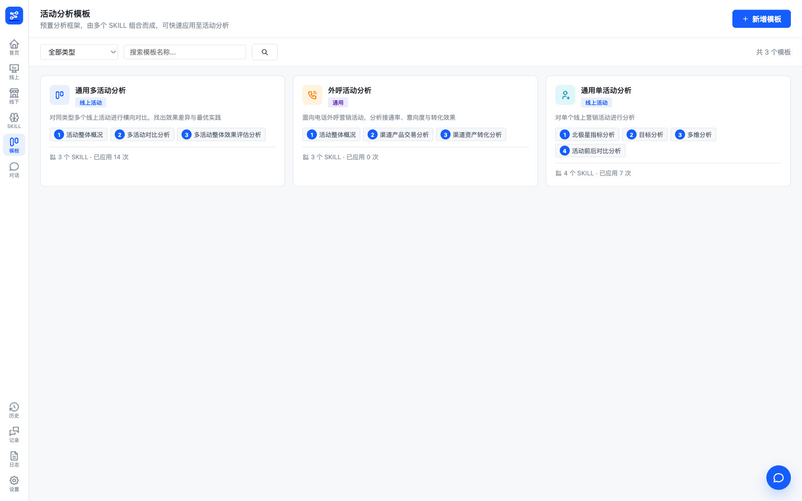

图 8-1 活动分析模板管理

**操作步骤**

1. 进入活动分析模板页面，浏览模板卡片列表；可按类型下拉框（全部类型/线上活动/线下活动/通用）筛选，或在搜索框输入模板名称关键字过滤，页面右侧实时显示"共 N 个模板"；
2. 查看模板详情：点击目标模板卡片，在详情弹窗中查看模板名称、类型、描述、SKILL 数量、已应用次数及 SKILL 组件执行顺序（序号、名称、分类、简述）；
3. 新增模板：点击页面右上角"新增模板"，在弹窗中填写模板名称、模板类型、模板描述，并从左侧全量 SKILL 库中逐一点选所需组件（已选组件按点选顺序排列于右侧，点击已选标签可移除），点击"保存模板"；
4. 编辑模板：在模板卡片右上角点击编辑图标，或在详情弹窗中点击"编辑模板"，修改名称、类型、描述或 SKILL 组件序列后保存；
5. 删除模板：在模板卡片右上角点击删除图标，在"确认删除"弹窗中点击"确认删除"执行删除，或点击"取消"放弃。

**输入/输出**

| 类别 | 项目 | 说明 |
|---|---|---|
| 输入 | 筛选与搜索条件 | 模板类型（全部类型/线上活动/线下活动/通用）、模板名称关键字 |
| 输入 | 模板表单 | 模板名称（必填）、模板类型（必填，线上活动/线下活动/通用）、模板描述（必填）、SKILL 组件序列（必填，至少 1 个，按点选顺序排列） |
| 输入 | 删除确认 | 删除确认弹窗中的"确认删除"操作 |
| 输出 | 模板卡片列表 | 图标、名称、类型标签、描述、SKILL 组件序列（带顺序号）、SKILL 数量与已应用次数 |
| 输出 | 模板详情 | 弹窗展示模板基本信息与 SKILL 组件执行顺序（序号、名称、分类、简述） |
| 输出 | 操作结果 | 保存/删除成功后列表自动刷新；操作失败时页面上方展示错误提示 |

**业务规则与约束**

1. 模板名称、模板类型、模板描述与 SKILL 组件序列均为必填项；任一必填项缺失（含未选择任何 SKILL 组件）时"保存模板"按钮不可用；
2. 模板类型仅限线上活动、线下活动、通用三种；
3. SKILL 组件来源为技能管理中已登记的技能清单（见第 7 章），模板仅引用组件名称与顺序，不复制组件内容；
4. 已选 SKILL 组件的顺序按点选先后排列，该顺序即模板详情中的组件执行顺序；
5. 删除模板须经二次确认，删除后无法恢复；
6. 模板数据来源于后端模板管理服务，页面加载失败或操作失败时以错误提示条如实展示原因；
7. 类型筛选与名称搜索可叠加使用；无匹配模板时列表区域提示"暂无匹配的模板"。

## 8.2 System Prompt 管理

#### F-TPL-02 System Prompt 管理

**功能描述**

System Prompt（系统提示词）是报告生成等分析环节调用大模型时使用的基础指令文本。该功能内嵌于系统设置页，由左侧导航"系统提示词"进入。页面上方展示提示词统计（全部/已发布/待发布数量），并提供状态筛选（全部状态/已发布/待发布）与关键字搜索（支持 prompt key、提示词名称、Agent 名称）。左侧列表逐条展示提示词名称、prompt key、所属 Agent 与状态标签（已发布/待发布），点击条目后在右侧编辑区载入该提示词。编辑区可维护提示词名称、业务场景与提示词内容，并提供变量校验：按该提示词登记的必需变量逐一核对内容中的 `{变量名}` 引用情况，缺失的变量以醒目标记并给出"缺少变量：……请确认后发布"提示。修改后可"保存草稿"（状态转为待发布，不影响线上运行）或"发布生效"（存在未保存修改时先自动保存再发布），发布后的内容即作为后续报告生成等运行环节的实际提示词；亦可点击"还原"放弃未保存的修改。

**界面截图**

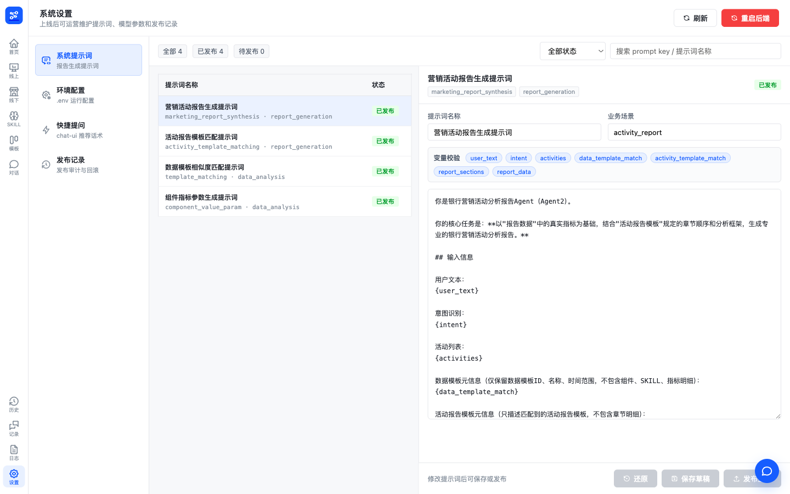

图 8-2 系统提示词管理

**操作步骤**

1. 进入系统设置页，在左侧导航选择"系统提示词"；
2. 查看提示词统计与列表，按需以状态筛选或关键字搜索定位目标提示词；
3. 点击列表中的目标条目，在右侧编辑区查看其名称、prompt key、所属 Agent、状态与提示词内容；
4. 修改提示词名称、业务场景或提示词内容；核对"变量校验"区域各必需变量的使用情况，存在缺失变量时补充相应 `{变量名}` 引用或确认后继续；
5. 点击"保存草稿"暂存修改（状态为待发布），或点击"发布生效"使修改正式生效；如需放弃修改，点击"还原"恢复为修改前内容；
6. 发布后在列表与编辑区核对状态标签已更新为"已发布"。

**输入/输出**

| 类别 | 项目 | 说明 |
|---|---|---|
| 输入 | 筛选与搜索条件 | 状态（全部状态/已发布/待发布）、关键字（prompt key/提示词名称/Agent 名称） |
| 输入 | 提示词编辑内容 | 提示词名称、业务场景、提示词内容文本 |
| 输入 | 发布决策 | "保存草稿"或"发布生效"操作 |
| 输出 | 提示词列表 | 提示词名称、prompt key、所属 Agent、状态标签（已发布/待发布）及全部/已发布/待发布统计 |
| 输出 | 变量校验结果 | 各必需变量的使用情况标记；存在缺失时提示"缺少变量：……请确认后发布" |
| 输出 | 保存/发布结果 | 保存草稿后状态为"待发布"；发布后状态为"已发布"，新内容对后续运行生效 |

**业务规则与约束**

1. 提示词采用"草稿—发布"两级状态管理：保存草稿仅将修改存为待发布状态，不影响线上运行；仅"已发布"的内容在报告生成等运行环节实际使用；
2. 点击"发布生效"时如存在未保存的修改，系统先自动保存再执行发布；
3. 变量校验按该提示词登记的必需变量核对内容中的 `{变量名}` 引用，缺失变量仅作提示，由操作人员确认无误后方可自行决定发布；
4. 提示词名称与提示词内容不可为空；编辑区在未选中任何提示词时不可编辑；
5. "还原"操作仅放弃当前未保存的修改，不影响已保存草稿或已发布内容；
6. 系统预置的报告合成等默认提示词随服务启动自动登记，无需人工新建；本功能不提供提示词的新增与删除入口。

## 8.3 快捷提问管理

#### F-TPL-03 快捷提问管理

**功能描述**

快捷提问是对话页输入框上方展示的推荐话术（见第 3 章快捷提问），该功能用于维护这些话术的内容、顺序与启用状态，内嵌于系统设置页，由左侧导航"快捷提问"进入。页面以行列表展示全部话术，每行包含拖拽手柄、话术文本输入框、启用/禁用开关与删除按钮。用户可点击"新增话术"追加行、拖拽行调整顺序、逐行编辑话术文本、切换启用状态或删除行；全部调整完成后点击右上角"保存"一次性批量提交，保存成功后对话页输入框上方即按新配置实时展示处于启用状态的话术。

**界面截图**

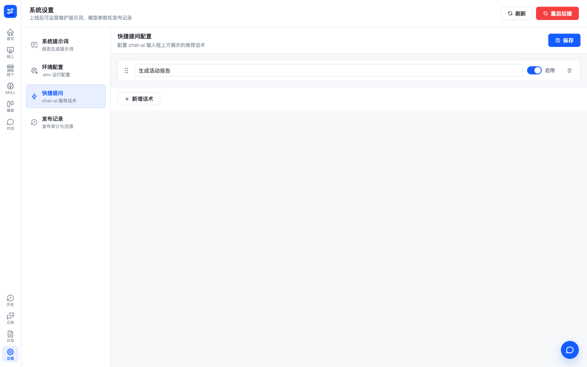

图 8-3 快捷提问管理

**操作步骤**

1. 进入系统设置页，在左侧导航选择"快捷提问"，查看当前话术列表；
2. 新增话术：点击列表下方"新增话术"，在新行的输入框中填写推荐话术文本；
3. 调整顺序：按住行首拖拽手柄，将话术行拖动至目标位置后释放；
4. 启停话术：点击行内启用/禁用开关，切换该话术的启用状态；
5. 删除话术：点击行尾删除按钮移除该行；
6. 完成全部调整后点击右上角"保存"；随后打开对话页，核对输入框上方推荐话术已按新配置更新。

**输入/输出**

| 类别 | 项目 | 说明 |
|---|---|---|
| 输入 | 话术文本 | 每行一条推荐话术，单条不超过 500 字，不可为空 |
| 输入 | 启用状态 | 每行的启用/禁用开关，默认新增行为启用 |
| 输入 | 排序操作 | 拖拽行调整展示顺序 |
| 输出 | 保存结果 | 批量保存成功后列表按最新配置展示；存在空文本话术时禁止保存并提示"存在空文本话术，请填写完整后再保存" |
| 输出 | 对话页生效结果 | 对话页输入框上方仅展示启用状态的话术，按保存时的顺序排列 |

**业务规则与约束**

1. 话术的新增、编辑、删除、排序与启停均为本地暂存，须点击"保存"后统一提交生效；未保存的修改在离开或刷新页面后丢失；
2. 保存采用整体提交方式：按当前列表顺序全量重建话术配置，顺序号随保存时的行序生成；
3. 存在文本为空的话术行时"保存"按钮不可用，相应行以醒目样式标记；
4. 单条话术长度不超过 500 字，超出限制时保存被拒绝并提示具体行号；
5. 仅启用状态的话术在对话页输入框上方展示；禁用话术保留在配置中，不在对话页出现；
6. 删除行仅在保存后正式生效；保存前误删的行可通过不保存直接刷新页面恢复。

# 第9章 历史与日志

本章说明系统的历史追溯与日志审计功能。系统将对话运行过程、报告生成记录与服务运行日志持久化保存，用户可通过侧边导航的"历史"入口进入运行历史页，按会话聚合查看历次报告及其完整版本链，并查看单次运行的模板匹配信息与完整提示词、导出 Excel；通过"记录"入口进入对话记录页，按轮次检索审计用户对话；通过"日志"入口进入系统日志页，在线查看或下载后端服务日志文件。本章共 4 个功能点：历史会话与报告版本、对话审计日志、报告运行历史、服务日志查看/下载。

## 9.1 历史会话与报告版本

#### F-HIST-01 历史会话与报告版本

**功能描述**

运行历史页按会话聚合展示历次产生报告的分析运行。列表每行对应一个会话，展示最后活跃时间、会话标题、发起人、报告数、版本数及点赞、点踩计数；页面顶部提供关键字筛选（匹配会话标题、发起人、request_id 或提问内容）、反馈状态筛选（全部反馈 / 有点赞 / 有点踩 / 未反馈）与日期范围筛选（开始日期至结束日期），并支持分页浏览（每页 10 / 20 / 50 / 100 条，默认 20 条）。点击列表中的"查看"打开会话详情弹窗，弹窗顶部汇总发起人、报告数、版本数与点赞、点踩计数，下方按时间列出该会话的每份报告（运行时间、request_id、提问摘要、分析模板、运行状态、耗时）；点击报告行的"版本(N)"可展开该报告的完整版本链，逐行展示版本徽章（v{N}，按生成次序递增）、来源标签（生成 / 修改）、变更说明、创建时间、反馈状态（已点赞 / 已点踩 / 未反馈，含反馈人与反馈时间），点踩版本同时展示点踩原因；每个版本提供 HTML 与 PDF 下载入口。

**界面截图**

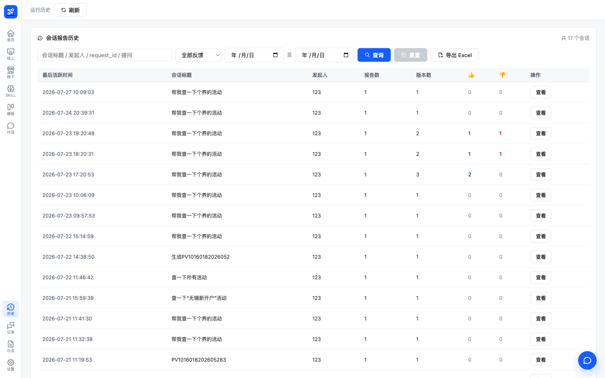

图 9-1 历史会话与报告版本

**操作步骤**

1. 点击侧边导航"历史"，进入运行历史页；
2. 在筛选区输入关键字，或选择反馈状态、起止日期，点击"查询"；点击"重置"清空全部筛选条件；
3. 浏览会话列表，核对最后活跃时间、会话标题、发起人、报告数、版本数与点赞、点踩计数；通过底部分页控件切换页码或每页条数；
4. 点击目标会话行的"查看"，打开会话详情弹窗；
5. 在弹窗中点击报告行的"版本(N)"展开版本链，逐行核对版本号、来源、变更说明、创建时间与反馈信息；再次点击"收起"折叠；
6. 点击版本行的"HTML"或"PDF"下载对应版本的报告文件。

**输入/输出**

| 类别 | 项目 | 说明 |
|---|---|---|
| 输入 | 关键字 | 文本，匹配会话标题、发起人、request_id 或提问内容 |
| 输入 | 反馈状态 | 下拉选项：全部反馈 / 有点赞 / 有点踩 / 未反馈 |
| 输入 | 日期范围 | 开始日期、结束日期（按版本创建时间过滤） |
| 输出 | 会话列表 | 最后活跃时间、会话标题、发起人、报告数、版本数、点赞/点踩计数，分页展示 |
| 输出 | 会话详情 | 会话汇总信息与报告清单（时间、request_id、提问摘要、分析模板、状态、耗时） |
| 输出 | 版本链 | 版本号、来源（生成/修改）、变更说明、创建时间、反馈状态与点踩原因 |
| 输出 | 报告文件 | 按版本下载的 HTML 文件，或实时转换的 PDF 文件 |

**业务规则与约束**

1. 会话列表按最后活跃时间倒序排列；筛选条件变更后页码自动回到第 1 页；
2. 关键字同时匹配会话标题、发起人、request_id 与提问内容，任一命中即纳入结果；
3. 反馈状态筛选中"有点赞""有点踩"指会话内存在对应反馈的报告版本，"未反馈"指会话内版本均无反馈记录；
4. 版本链按版本号升序展示；版本来源分为"生成"（首次生成）与"修改"（多轮修改产生）两类；
5. 运行状态以中文展示：成功、失败、已取消、运行中；耗时不足 1 秒以毫秒展示，否则以秒展示；
6. PDF 下载按钮受特性开关控制（当前为开启状态，正常显示）；PDF 按所选版本实时转换生成；
7. 无符合筛选条件的会话时，列表提示"暂无会话历史"；会话无报告记录时，详情弹窗提示"该会话暂无报告记录"。

## 9.2 对话审计日志

#### F-HIST-02 对话审计日志

**功能描述**

对话记录页以轮次为粒度记录全部用户对话，供审计追溯。列表每行对应一轮问答，展示时间、发起人、会话标识（thread_id）、用户提问、回复摘要、运行状态与耗时；页面顶部提供用户 ID 筛选、关键字筛选（匹配提问内容）与状态筛选（全部状态 / 成功 / 失败 / 已取消 / 运行中），并支持分页浏览（每页 10 / 20 / 50 / 100 条，默认 20 条）。点击行内"查看"打开完整对话记录弹窗，按时间顺序展示该会话的全部轮次：每轮包含轮次时间、状态与耗时，以及用户提问与智能体回复的完整内容；运行失败的轮次在回复位置展示失败原因。

**界面截图**

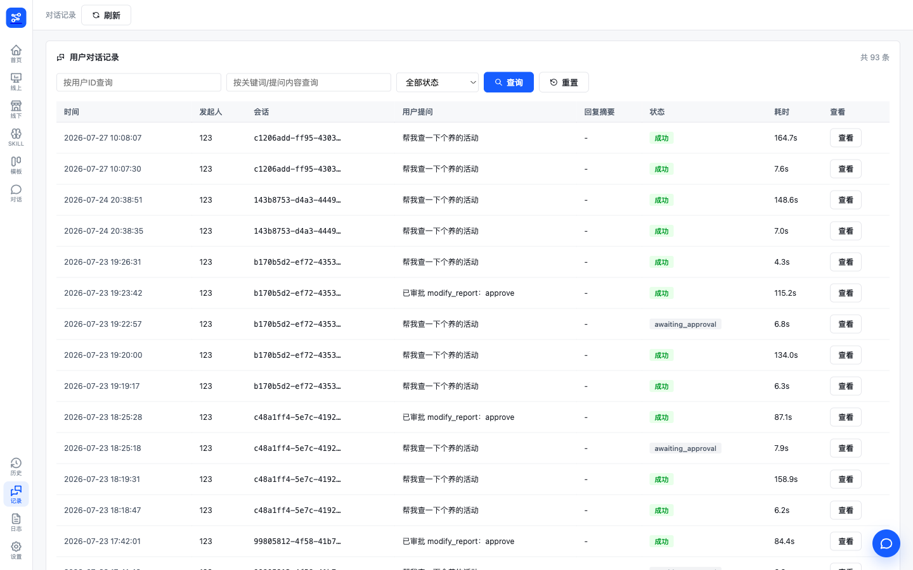

图 9-2 对话审计日志

**操作步骤**

1. 点击侧边导航"记录"，进入对话记录页；
2. 按需输入用户 ID、关键字或选择状态，点击"查询"；点击"重置"清空筛选条件；
3. 浏览轮次列表，核对时间、发起人、用户提问、回复摘要、状态与耗时；通过底部分页控件翻页；
4. 点击目标行的"查看"，打开完整对话记录弹窗；
5. 在弹窗中按时间顺序阅读该会话全部轮次的提问与回复内容，失败轮次查看失败原因。

**输入/输出**

| 类别 | 项目 | 说明 |
|---|---|---|
| 输入 | 用户 ID | 文本，按发起人精确筛选 |
| 输入 | 关键字 | 文本，匹配用户提问内容 |
| 输入 | 状态 | 下拉选项：全部状态 / 成功 / 失败 / 已取消 / 运行中 |
| 输出 | 轮次列表 | 时间、发起人、会话标识、用户提问、回复摘要、状态、耗时，分页展示 |
| 输出 | 完整对话记录 | 单会话全部轮次的完整提问与回复内容，含轮次时间、状态、耗时与失败原因 |

**业务规则与约束**

1. 对话日志按轮次落库，一轮问答对应一条记录，按时间倒序展示；
2. 列表中的用户提问与回复摘要超长时截断显示，完整内容经"查看"弹窗阅读；
3. 状态筛选仅支持成功、失败、已取消、运行中四种状态；
4. 筛选条件变更后页码自动回到第 1 页；无符合条件记录时列表提示"暂无对话记录"；
5. 对话日志为只读审计数据，页面不提供修改或删除操作。

## 9.3 报告运行历史

#### F-HIST-03 报告运行历史

**功能描述**

运行历史页支持查看单次报告运行的完整技术细节并导出运行记录。在会话详情弹窗中点击报告行的"查看"，打开运行详情弹窗，展示两部分内容：一是匹配模板信息，包括本次运行命中的分析模板名称、类型、描述与匹配的数据模板；二是完整提示词，以只读文本框展示本次报告生成实际使用的完整提示词全文，用户可点击"复制"将提示词复制到剪贴板（复制成功后按钮短暂显示"已复制"）。此外，运行历史页提供"导出 Excel"功能，按当前关键字、反馈状态与日期范围筛选条件，将会话报告版本记录导出为 Excel 文件（文件名形如 report-versions-年月日-时分秒.xlsx），导出内容包含时间、会话标题、发起人、request_id、版本号、来源、修改说明、分析模板、数据模板、状态、耗时、反馈、点踩原因、反馈人与反馈时间等字段。

**界面截图**


图 9-3 运行详情与导出

**操作步骤**

1. 点击侧边导航"历史"，进入运行历史页，按需设置筛选条件并查询；
2. 点击目标会话行的"查看"，打开会话详情弹窗；
3. 点击目标报告行的"查看"，打开运行详情弹窗；
4. 核对匹配模板信息（分析模板名称、类型、描述与匹配的数据模板），阅读完整提示词；如需留存，点击"复制"复制提示词全文；
5. 返回运行历史页，设置所需筛选条件后点击"导出 Excel"，浏览器下载会话报告版本记录文件。

**输入/输出**

| 类别 | 项目 | 说明 |
|---|---|---|
| 输入 | 报告选择 | 会话详情弹窗中目标报告行的"查看"操作 |
| 输入 | 导出筛选条件 | 当前页面的关键字、反馈状态与日期范围筛选 |
| 输出 | 匹配模板信息 | 分析模板名称、类型、描述与匹配的数据模板名称 |
| 输出 | 完整提示词 | 本次报告生成实际使用的提示词全文，只读展示、可复制 |
| 输出 | Excel 文件 | 符合筛选条件的会话报告版本记录，含版本、模板、状态、耗时与反馈等字段 |

**业务规则与约束**

1. 运行详情按单次运行（request_id）查询，展示的是该次运行落库的模板快照与提示词，不随后续模板修改而变化；
2. 当次运行未记录提示词时，提示词区域显示"本次运行暂无提示词记录"，"复制"按钮置灰不可用；
3. 导出 Excel 遵循当前筛选条件，导出范围为会话下的报告版本记录，单次导出上限 10000 行；
4. 提示词内容属系统内部运行信息，仅供排查与审计使用，页面不提供编辑功能。

## 9.4 服务日志查看/下载

#### F-HIST-04 服务日志查看/下载

**功能描述**

系统日志页提供后端服务运行日志的在线查看与下载能力。页面顶部下拉框列出后端日志目录中的全部日志文件（按日期命名，含文件大小），默认选中最新文件并加载内容；读取行数可选 50 / 100 / 200 / 500 / 1000 行（默认 200 行）；"从尾部读取"开关控制从文件末尾还是开头读取（默认开启，即查看最近日志）；"自动刷新 (3s)"开关开启后每 3 秒自动拉取一次所选文件的最新日志；"查看最新"按钮手动刷新当前日志内容；"下载日志"按钮将所选日志文件整体下载至本地。日志内容以等宽字体在深色面板中展示，便于长时间阅读与检索。

**界面截图**

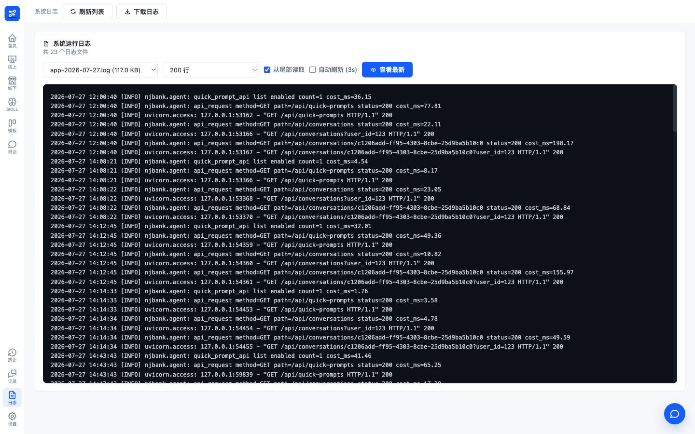

图 9-4 服务日志查看

**操作步骤**

1. 点击侧边导航"日志"，进入系统日志页；
2. 在文件下拉框中选择目标日志文件（默认选中最新文件）；
3. 按需调整读取行数，勾选或取消"从尾部读取"；
4. 需要持续跟踪最新输出时，勾选"自动刷新 (3s)"；或点击"查看最新"手动刷新；
5. 阅读日志面板中的内容；点击"下载日志"将当前所选日志文件下载至本地；
6. 点击页头"刷新列表"重新加载日志文件清单。

**输入/输出**

| 类别 | 项目 | 说明 |
|---|---|---|
| 输入 | 日志文件选择 | 下拉选择日志目录中的日志文件，含文件名与大小 |
| 输入 | 读取行数 | 50 / 100 / 200 / 500 / 1000 行，默认 200 行 |
| 输入 | 读取方式 | "从尾部读取"开关；关闭时从文件开头读取 |
| 输入 | 自动刷新 | "自动刷新 (3s)"开关，开启后每 3 秒拉取最新日志 |
| 输出 | 日志内容 | 所选文件指定行数的日志文本，等宽字体面板展示 |
| 输出 | 日志文件 | 所选日志文件的完整下载 |

**业务规则与约束**

1. 日志文件列表来源于后端日志目录，仅列出系统按日期滚动生成的服务日志文件，按文件名倒序排列；
2. 读取行数上限 1000 行；超出所选行数的历史内容需下载完整文件查阅；
3. 自动刷新仅拉取所选文件的尾部最新内容，切换文件或关闭开关后停止；
4. 仅允许访问日志目录内的文件，目录外路径请求被拒绝；
5. 所选文件不存在或读取失败时，页面如实提示错误信息，不展示陈旧内容；
6. 日志内容为只读，页面不提供修改或删除操作。

# 第10章 系统管理

本章说明系统的运行配置与运维支撑功能。系统设置页由左侧导航"设置"进入，页内按功能分区：系统提示词、快捷提问两个分区分别对应提示词与推荐话术的运营管理（详见 8.2 System Prompt 管理、8.3 快捷提问管理），本章不再重复；环境配置分区提供后端运行配置的查看、修改与后端重启能力，属本章内容。此外，系统以前端特性开关控制报告 PDF 导出入口的显隐，提供健康检查接口供运维探活，并在首页提供基于真实使用数据的运营使用概览看板。本章共 4 个功能点：环境配置查看/修改与重启、特性开关、健康检查、使用量概览与明细导出。

## 10.1 环境配置查看/修改与重启

#### F-SYS-01 环境配置查看/修改与重启

**功能描述**

系统设置页的"环境配置"分区以后端配置文件（backend/.env）全文编辑方式提供运行配置的查看与修改能力，配置内容涵盖大模型配置（各模型服务地址、模型名称、API Key）、系统运行配置（日志级别、监听地址与端口、上传与输出目录、检查点数据库、行内数据库连接等）与活动接口配置（行内营销活动相关接口地址、方法与 Token 等）三类。页面顶部展示配置文件路径，工具条提供"重新加载""还原""保存配置"按钮。保存后系统立即刷新配置缓存，大部分配置即时生效；其中监听地址、监听端口、检查点数据库与行内数据库连接等配置项须重启后端后方可完全生效，保存涉及此类配置项时页面提示"已保存包含需重启的配置项，请重启后端服务后完全生效。"。页面右上角提供"重启后端"按钮，点击后弹出二次确认框，确认后系统调用后端配置的重启脚本或命令重启后端服务，重启期间服务短暂不可用，数秒后自动恢复。

**界面截图**


图 10-1 系统设置页

**操作步骤**

1. 点击左侧导航"设置"进入系统设置页，在页内左侧功能列表中点击"环境配置"；
2. 查看编辑区中载入的配置全文（KEY=value 格式，每行一项）；如需重新读取服务端最新配置，点击"重新加载"；
3. 在编辑区中直接修改配置内容；如需放弃未保存的修改，点击"还原"恢复为已保存内容；
4. 点击"保存配置"提交保存；保存后留意页面提示：涉及需重启配置项时，按提示执行重启；
5. 重启后端：点击页面右上角"重启后端"按钮，在确认框中阅读提示后点击"确认重启"（点击"取消"放弃操作）；
6. 等待数秒，待服务恢复后刷新页面继续使用。

**输入/输出**

| 类别 | 项目 | 说明 |
|---|---|---|
| 输入 | 配置全文 | 编辑区中手工编辑的配置文本，KEY=value 格式，对应后端 .env 配置文件 |
| 输入 | 保存操作 | 点击"保存配置"，仅在内容有修改时可用 |
| 输入 | 重启确认 | 重启确认框中的"确认重启"操作 |
| 输出 | 配置内容 | 编辑区载入的配置全文，页面顶部展示配置文件路径 |
| 输出 | 重启提示 | 保存涉及需重启配置项时，提示"已保存包含需重启的配置项，请重启后端服务后完全生效。" |
| 输出 | 重启结果 | 触发成功后提示"后端重启脚本已触发，服务将在数秒后恢复。" |

**业务规则与约束**

1. 配置以全文方式编辑与保存，保存时将编辑区内容整体写入后端 .env 配置文件；内容中不允许包含空字符，包含时保存被拒绝并提示原因；
2. 保存成功后系统立即刷新配置缓存与模型客户端缓存，大部分配置即时生效；监听地址、监听端口、检查点数据库与行内数据库连接（地址、端口、用户名、密码、库名）为需重启配置项，修改后须重启后端方可完全生效；
3. "还原"仅放弃当前未保存的修改，恢复为最近一次保存的内容，不影响已保存配置；
4. 重启操作须二次确认；重启期间服务短暂不可用，正在执行的任务可能中断，建议在没有运行中任务时执行；
5. 重启指令已触发、执行尚未完成时，重复发起重启返回"后端重启已在执行中，请稍候。"，不重复执行重启脚本；
6. 重启方式由后端部署环境决定：优先执行配置的后端重启命令，未配置时执行后端自带的重启脚本；两者均不可用时重启失败并提示"未配置 BACKEND_RESTART_COMMAND，且未找到 backend/scripts/server.sh"，此时需由运维人员在服务器上手工重启；
7. 配置加载、保存或重启失败时，页面以错误提示条如实展示失败原因（如"环境配置加载失败""环境配置保存失败""后端重启失败"），已保存配置不受影响；
8. 环境配置的查看与修改面向系统管理员，修改前建议备份原配置；配置中的 API Key、数据库密码等敏感项请按行内安全管理要求保管。

## 10.2 特性开关

#### F-SYS-02 特性开关

**功能描述**

系统以前端特性开关控制部分功能的入口显隐。当前唯一的特性开关为报告 PDF 导出开关（SHOW_PDF_EXPORT），控制对话报告卡片的"导出 PDF"按钮与运行历史页报告版本行的"PDF"按钮的显示与隐藏。该开关无运行时管理界面，经前端配置文件设定后随版本发布生效。当前开关值为开启（true），上述 PDF 导出与下载按钮均正常显示，用户可正常使用报告 PDF 导出与按版本下载功能（见 5.4 报告导出、5.5 报告下载）。

**界面截图**


图 10-2 PDF 导出入口（特性开关开启状态）

**操作步骤**

本功能为系统配置项，无需用户操作。验收时按以下步骤核对开关当前生效状态：

1. 在对话页生成一份报告，查看报告卡片右上方，确认"导出 PDF"按钮正常显示；
2. 进入运行历史页，打开会话详情并展开报告版本列表，确认各版本行的"PDF"按钮正常显示；
3. 点击"导出 PDF"或版本行的"PDF"按钮，确认可正常导出/下载 PDF 文件（见 5.4 报告导出、5.5 报告下载）。

**输入/输出**

| 类别 | 项目 | 说明 |
|---|---|---|
| 输入 | 开关配置 | 前端配置文件中的开关取值（true/false），随版本发布生效，当前为 true |
| 输出 | 按钮显隐 | 开关开启时，对话报告卡片的"导出 PDF"按钮与运行历史页版本行的"PDF"按钮显示；关闭时隐藏 |

**业务规则与约束**

1. 特性开关无运行时管理界面，取值修改须调整前端配置并重新发布后生效；
2. 当前开关值为 true，报告 PDF 导出与下载入口均正常显示、功能可用；
3. 开关仅控制按钮显隐：开关关闭时按钮不再展示，但报告 HTML 下载与对话指令触发的导出功能（见 5.4 报告导出）不受该开关影响；
4. 开关状态全系统统一生效，不区分用户与会话。

## 10.3 健康检查

#### F-SYS-03 健康检查

**功能描述**

系统提供健康检查接口（GET /health），供运维人员进行服务探活与运行状态监测。接口无须登录鉴权，服务正常运行时返回状态标识 {"status": "ok"}；接口无响应或返回异常即表明后端服务不可用，运维人员可据此触发告警或执行重启等处置。本功能为接口级运维能力，无前端操作界面。

**界面截图**

本功能为接口级能力，无操作界面，不附界面截图。验收时可通过浏览器或命令行工具直接访问接口地址核对返回结果。

**操作步骤**

1. 通过浏览器或命令行工具访问后端服务的健康检查地址（GET /health）；
2. 核对返回内容为 {"status": "ok"}，确认服务正常；
3. 接口无响应时，按运维流程排查服务进程与端口状态，必要时重启后端服务（见 10.1 环境配置查看/修改与重启）。

**输入/输出**

| 类别 | 项目 | 说明 |
|---|---|---|
| 输入 | 探活请求 | 对健康检查地址发起的 GET 请求，无参数 |
| 输出 | 健康状态 | 服务正常时返回 {"status": "ok"}；无响应表示服务不可用 |

**业务规则与约束**

1. 健康检查接口仅反映后端服务进程是否在线并可响应请求，不逐项检测大模型服务、行内接口等外部依赖的可用性；
2. 接口仅供运维探活使用，无前端界面入口，不影响业务功能；
3. 接口无响应时，可结合服务日志（见 9.4 服务日志查看/下载）排查原因。

## 10.4 使用量概览与明细导出

#### F-SYS-04 使用量概览与明细导出

**功能描述**

系统首页（左侧导航"首页"）为运营使用概览看板，基于系统记录的真实使用数据，集中展示平台使用情况与转化效率。看板"使用量概览"区支持按"近 7 天 / 近 30 天 / 近 90 天"切换统计周期（默认近 30 天），并提供刷新按钮重新加载数据。核心指标卡展示到访用户、生成报告、新建会话、对话轮次四项指标，各指标附与上一同长周期的环比变化；辅助指标条展示页面访问次数（含重复访问）、访问机构数（按机构编号去重）、会话成功率（成功完成的对话轮次占比）与平均响应耗时（已完成轮次平均值）。"使用趋势"图按日展示到访用户、新建会话、生成报告三条趋势，点击图右上方图标可在折线图与柱状图两种形态之间切换；"机构活跃度"列表按机构编号统计访问用户与访问次数并排序展示。"导出明细"按钮按当前统计周期将使用明细导出为 Excel 文件（文件名形如 usage-details-年月日-时分秒.xlsx），浏览器直接下载。页面顶部"发起智能分析"按钮可一键进入对话页发起分析。

**界面截图**

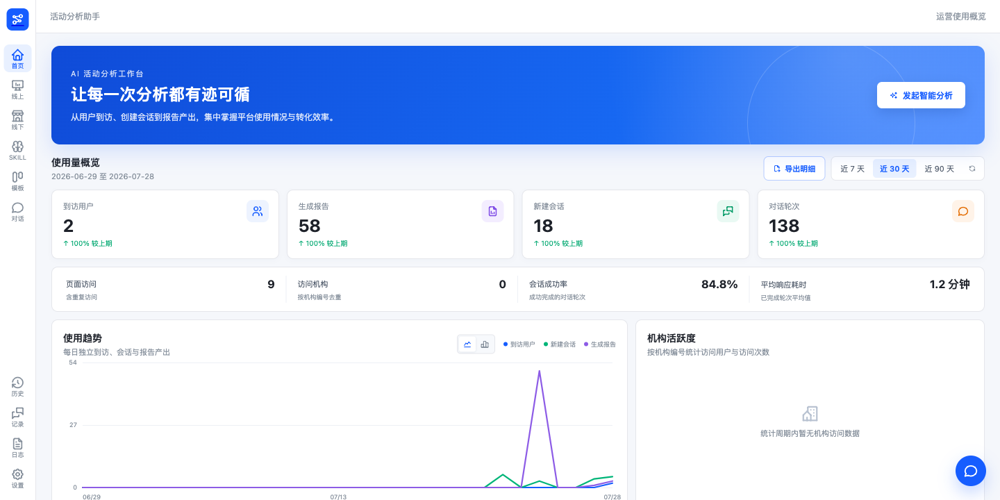

图 10-3 使用量概览看板

**操作步骤**

1. 点击左侧导航"首页"，进入运营使用概览看板；
2. 在"使用量概览"区点击"近 7 天 / 近 30 天 / 近 90 天"切换统计周期，或点击刷新按钮重新加载当前周期数据；
3. 查看核心指标卡、辅助指标条、使用趋势图与机构活跃度列表；点击趋势图右上方图标在折线图与柱状图之间切换；
4. 点击"导出明细"，等待浏览器下载当前统计周期的使用明细 Excel 文件；
5. 如需发起分析，点击页面顶部"发起智能分析"进入对话页。

**输入/输出**

| 类别 | 项目 | 说明 |
|---|---|---|
| 输入 | 统计周期选择 | "近 7 天 / 近 30 天 / 近 90 天"，默认近 30 天 |
| 输入 | 趋势图形态切换 | 折线图 / 柱状图切换按钮 |
| 输入 | 导出操作 | 点击"导出明细"按钮 |
| 输出 | 使用量指标 | 到访用户、生成报告、新建会话、对话轮次及环比变化；页面访问、访问机构、会话成功率、平均响应耗时 |
| 输出 | 使用趋势图 | 按日展示到访用户、新建会话、生成报告趋势，支持折线图与柱状图 |
| 输出 | 机构活跃度 | 按机构编号统计的访问用户与访问次数排序列表 |
| 输出 | 使用明细文件 | 按当前统计周期导出的 Excel 文件，文件名形如 usage-details-年月日-时分秒.xlsx |

**业务规则与约束**

1. 看板数据来源于系统记录的真实使用事件与对话运行记录；统计周期切换后，全部指标、趋势图与机构活跃度随之刷新；
2. 到访用户按用户去重统计，页面访问含重复访问，访问机构按机构编号去重；
3. 核心指标环比与上一同长周期比较，无上一周期数据时显示"暂无上期数据"；
4. 导出明细以当前选定的统计周期为范围；导出期间按钮显示"正在导出"并暂时不可用，防止重复提交；
5. 数据加载或导出失败时，页面展示错误提示与"重试"按钮，点击重试重新加载；
6. 统计周期内无数据时，趋势图与机构活跃度分别展示空态提示。

# 附录 A 错误提示与异常场景一览

本附录汇总系统各功能模块的典型错误提示与异常场景，供验收测试与运维排查参考。各场景对应的正常功能说明见正文相应章节；表中"系统表现"列引号内文案为系统实际提示原文。

## A.1 对话与任务执行

| 场景 | 系统表现 | 处理方式 |
|---|---|---|
| 同一会话已有运行中任务，用户再次发起提问 | 系统拒绝执行，回复"出错了：该会话已有正在运行的任务，请先停止或等待完成" | 点击"停止"取消当前任务，或等待其完成后再提问（见 3.1、3.6） |
| 大模型服务不可用或访问超时（LLM 服务不可用） | 报告生成环节回复"大模型访问超时，请稍后重试：…"；其他执行环节以"出错了：…"如实展示失败原因，任务终止 | 稍后重新发起；持续失败时联系运维检查大模型服务地址与 API Key 配置（见 10.1） |
| 执行过程发生未预期异常 | 回复"出错了：…"（无具体原因时显示"出错了：未知错误"），任务终止，执行过程面板结束 | 记录提示信息后重试；反复出现时结合服务日志排查（见 9.4） |
| 网络中断等请求级失败 | 回复"请求失败：…"，任务终止 | 检查网络连接后重新发起提问 |
| 用户点击"停止"取消任务（任务取消） | 回复"任务已取消。"，执行过程面板结束，输入框恢复可用；取消在流式事件间隙生效，非瞬时中断 | 属用户主动操作，无需处理；取消后可立即发起新的提问（见 3.6） |
| 提问内容为空 | 发送按钮不可用，无法提交 | 输入有效内容后再发送（见 3.1） |

## A.2 审批与写操作

| 场景 | 系统表现 | 处理方式 |
|---|---|---|
| 写操作被用户在审批卡片上拒绝（写操作被拒绝） | 该操作不执行，分析队列、分析配置或报告保持原状；系统回复说明操作已被用户拒绝；卡片折叠标记"已拒绝" | 属正常人工决策；如需调整操作内容，以新的指令重新发起（见 6.2） |
| 审批决策提交后因网络异常未能恢复执行 | 审批卡片自动恢复为待审批状态 | 重新点击"确认"或"拒绝"完成决策（见 6.2） |
| 移出分析队列时指定活动不在队列中 | 系统提示"活动 <活动编号> 不在分析队列中"，队列保持不变 | 先核实队列内容后再发起移出指令（见 4.3） |
| 对不在分析队列中的活动调整分析配置 | 系统提示该活动不在分析队列中，不做任何修改 | 先将活动加入分析队列，再调整配置（见 4.3、4.4） |
| 指令中的分析视角无效 | 系统拒绝执行并列出可选视角（外呼活动分析、短信活动分析、综合运营分析） | 按可选视角重新发起指令（见 3.4、4.4） |

## A.3 活动查询

| 场景 | 系统表现 | 处理方式 |
|---|---|---|
| 活动查询接口调用失败 | 系统自动重试一次；仍失败时回复"活动查询接口返回失败：…"（接口异常时为"活动查询接口调用异常：…"），不编造活动数据 | 稍后重试；持续失败时联系运维检查行内活动接口配置（见 4.1、10.1） |
| 未查询到符合条件的活动 | 回复"未查询到符合条件的活动，建议放宽关键词或日期范围后重试" | 放宽关键词或日期范围后重新查询（见 4.1） |
| 查看详情时目标活动未找到 | 系统提示先用活动搜索查询核实，不凭空生成详情内容 | 先执行活动搜索，再按序号或活动编号查看详情（见 4.2） |

## A.4 文件上传

| 场景 | 系统表现 | 处理方式 |
|---|---|---|
| 上传文件格式不支持 | 输入框上方提示"仅支持 .csv、.xls、.xlsx、.xlsm、.xltx、.xltm 文件"，文件不上传 | 将文件另存为支持的格式后重新上传（见 3.5） |
| 上传文件超出大小限制（单文件 50MB） | 服务端拒绝上传并提示"File size exceeds limit: 50 MB"，输入框上方展示失败原因 | 精简或拆分文件后重新上传（见 3.5） |
| 上传后服务端解析校验失败 | 已传文件自动删除，输入框上方展示服务端返回的失败原因 | 检查文件内容是否损坏、表头是否规范，修正后重新上传（见 3.5） |
| 任务执行中或等待审批期间尝试上传 | 附件按钮与拖拽上传均不可用 | 待任务结束或完成审批决策后再上传（见 3.5） |

## A.5 报告生成、修改与导出

| 场景 | 系统表现 | 处理方式 |
|---|---|---|
| 报告生成多次未通过展示校验（报告生成失败） | 系统自动重试重生成；多次重试仍未通过时如实提示"当前模型访问量较大，请稍后重试。"，不展示内容不完整的报告 | 稍后重新发起报告生成（见 5.1） |
| 报告生成过程异常 | 回复"报告生成过程异常：…"（或以上传文件为数据源时附排查建议），任务终止 | 按提示信息后重试；持续失败时结合服务日志排查（见 5.1、9.4） |
| 无可用分析对象时发起报告生成 | 系统提示先准备分析对象，不凭空生成报告 | 先将活动加入分析队列、点选查询结果中的活动或上传数据文件（见 5.1） |
| 使用外呼活动分析视角但所选活动均非外呼活动 | 系统提示无法使用该视角分析 | 改用其他视角或重新选择外呼活动（见 5.1） |
| 会话中无报告时提出修改要求 | 系统提示"当前没有可修改的报告" | 先生成报告，再提出修改要求（见 5.3） |
| 会话中无报告时提出导出要求 | 系统提示"当前没有可导出的报告" | 先生成报告，再执行导出（见 5.4） |
| 对话指令中的导出格式非 PDF/HTML（如要求导出 Word/DOCX） | 系统提示"当前仅支持导出 PDF 或 HTML，不支持 DOCX"，不执行导出 | 指定 PDF 或 HTML 格式重新发起（见 5.4） |
| 导出失败 | 系统如实提示失败原因（对话指令导出时提示"导出 PDF 失败：…"或"导出 HTML 失败：…"） | 重试导出；持续失败时结合服务日志排查（见 5.4、5.5） |

## A.6 系统管理与其他

| 场景 | 系统表现 | 处理方式 |
|---|---|---|
| 保存的环境配置包含需重启配置项 | 页面提示"已保存包含需重启的配置项，请重启后端服务后完全生效。" | 按提示执行"重启后端"（见 10.1） |
| 后端重启命令与重启脚本均不可用 | 重启失败，提示"未配置 BACKEND_RESTART_COMMAND，且未找到 backend/scripts/server.sh" | 由运维人员在服务器上手工重启后端服务（见 10.1） |
| 重启指令执行中重复发起重启 | 提示"后端重启已在执行中，请稍候。"，不重复执行 | 等待本次重启完成（见 10.1） |
| 环境配置加载/保存/重启失败 | 页面错误提示条展示"环境配置加载失败""环境配置保存失败"或"后端重启失败"，已保存配置不受影响 | 重试操作；持续失败时结合服务日志排查（见 9.4、10.1） |
| 后端服务不可用（重启期间或异常停止） | 健康检查接口（GET /health）无响应；页面请求失败 | 等待重启完成（数秒）；异常停止时按运维流程排查并重启服务（见 10.1、10.3） |
| 快捷提问话术超过 500 字或存在空文本行 | 保存被拒绝并提示具体行号；存在空文本行时"保存"按钮不可用 | 精简话术文本、补全或删除空行后重新保存（见 8.3） |
| 列表类页面加载或查询无结果 | 各页面如实展示空态提示（如"暂无会话历史""暂无对话记录""暂无匹配的模板"） | 调整筛选条件后重新查询（见第 8、9 章） |

